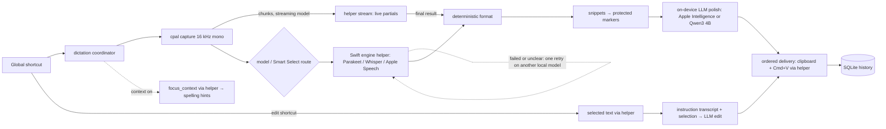

<!-- FilePath: docs/internal/architecture.md -->

# Simple Voice — Architecture

Simple Voice is a Tauri 2 app with three parts:

| Part          | Path         | Language                                         | Owns                                                                                                                                                                                                                                                                                                                                                                                                                                                               |
| ------------- | ------------ | ------------------------------------------------ | ------------------------------------------------------------------------------------------------------------------------------------------------------------------------------------------------------------------------------------------------------------------------------------------------------------------------------------------------------------------------------------------------------------------------------------------------------------------ |
| Core          | `src-tauri/` | Rust (`#![forbid(unsafe_code)]`)                 | Database, audio capture, dictation pipeline, meetings, shortcuts, windows, tray, sounds                                                                                                                                                                                                                                                                                                                                                                            |
| Engine helper | `engine/`    | Swift (SwiftPM executable `simple-voice-engine`) | Everything that needs Apple frameworks or native inference: Parakeet (FluidAudio, Core ML) incl. streaming, Whisper (WhisperKit), Apple Speech (`SpeechAnalyzer`, on-device only), Apple Intelligence and the local LLM (llama.cpp), speaker diarization (FluidAudio), system-audio capture (ScreenCaptureKit), model downloads, permissions, frontmost app, focused-field context, selected text, synthetic Cmd+V / Cmd+C, output mute, the floating overlay pill |
| UI            | `src/`       | React + TypeScript (Vite)                        | The main window (`index.html`)                                                                                                                                                                                                                                                                                                                                                                                                                                     |

Rust forbids `unsafe`, so every Objective-C / C API call lives in the Swift helper. The helper is
bundled as a Tauri sidecar (`bundle.externalBin = ["binaries/simple-voice-engine"]`), started
once at app launch, kept resident (so Core ML models stay loaded), and restarted when it exits
(after 1, 2, 5, 10, 20, then every 30 s; the pause resets once it stayed up a minute).
Settings shows why it is down (`engine-status`) and starts it at once on request
(`restart_engine`).

Nothing leaves the Mac. Every model runs on-device through the helper; the only network
requests are user-started model downloads (`download_model`, pinned Hugging Face revisions) and
the daily latest-release check (`features/updates/releases.rs`). Neither carries user content.
There are no accounts, API keys or telemetry.



Per-app style (U-4): at recording start the coordinator resolves `Settings::style_for(bundle_id,
app_name)`: an `appStyles` bundle-id override, else `categoryStyles[categorize(..)]`, else the
global `style`. The session's `settings.style` is replaced by it and `history.style` /
`history.style_source` record what was used. The user explicitly chose per-app styles over the
earlier global-only policy.

Context (CX-1..CX-4): with `foregroundContext` (any app) or `ideContext` (Code-category apps),
`features/dictation/context.rs` asks the helper for `focus_context` (≤ `sv_text::context::
FOCUS_MAX_CHARS` UTF-16 units around the caret; excluded apps and secure fields are never read)
in parallel with the recording start. A read that reports a reason, times out, or comes from a
different app than the one the recording started in yields nothing. `sv_text::context::
context_terms` / `ide_terms` reduce the text to a bounded list of names, file names and
identifiers, which `Vocabulary::add_context_terms` appends after the dictionary and pack words
for that dictation only. The field text is never stored or logged.

Live transcript (LT-1..LT-4): `features/dictation/live.rs`. When `liveTranscript` is on, the
coordinator starts the recorder with a chunk sink (`Recorder::start_with`) feeding a bounded
queue (256 chunks ≈ 8 s); a feeder task opens `stream_start` for the chosen voice model, or
Smart Select's top-ranked model (the helper refuses non-streaming models: Whisper), and forwards ~200 ms batches with
`stream_audio`. `stream_partial` events become `dictation-partial` (≤ ~8/s) and the helper draws
them in the pill. The stream is display only: on stop or cancel the pipeline calls
`stream_cancel` and transcribes the whole recording as without live transcript (Parakeet's
sliding-window stream is slightly less accurate than a batch pass), so the pasted text never
repeats a segment. An overflowed queue, `stream_failed` or a helper restart only ends the live
display. A cold model can take ~30 s to open a stream; the 10 s start limit then skips live
display for that recording (the launch preload normally keeps the model warm).

Snippets (SN-1..SN-4): after deterministic formatting, `sv_text::snippets::protect` replaces
each trigger hit (case-insensitive, whole words, longest first, one pass) with an `[[Sn]]`
marker; the polish prompt gets `MARKER_RULE`; `Protected::restore` puts the payloads back
verbatim and returns `None` when the model lost or altered a marker, in which case the
deterministic text with snippets expanded is pasted (status `unformatted`). With polish off,
`expand` runs directly.

Edit mode (requirements ED-1..ED-7) reuses the dictation path: the edit shortcut starts a
recording whose `SessionInput.selection` carries the selection read started at key-down;
`pipeline::run_session` hands such a session to `features/dictation/edit.rs`, which transcribes
the instruction, sends `sv_text::edit_prompt` to the post-processing model through
`features/llm.rs` (shared with the formatting pass, learning and meetings), checks the reply with
`sv_text::accept_edit`, and pastes it without a trailing separator only while the app the edit
started in is still frontmost.

Learning from corrections (requirements LC-1..LC-6) follows a pasted dictation into its field:
when `Settings.learnFromEdits` is on and post-processing is not off, the coordinator sends the
helper `prepare_edit_watch` at every recording start (ending the previous watch before a new
paste can change the field), and `pipeline::run_session` hands each pasted dictation to
`features/dictation/learning.rs`. That task awaits `watch_edits`, stores a changed text as
`history.edited_text`, reduces it to word substitutions with `sv_text::corrections`, re-reads the
setting, asks the post-processing model through `llm.rs` with `sv_text::learning_prompt`,
keeps only the offered corrections via `sv_text::accept_learning`, and adds them with
`Db::learn_words`, emitting `dictionary-changed`.

## 1. Storage

- Data directory: `~/.simplevoice/` (created on launch, mode 0700). Debug builds (`just dev`)
  use `~/.simplevoice-dev/` with the same layout, so a development migration never touches the
  installed release's database; everything below lives under whichever directory the build uses.
    - `update.log` — output of the last in-app update install (file mode 0600), replaced by each.
    - `simple-voice.db` — default database location (file mode 0600).
    - `location` — optional one-line file holding the absolute path of the directory that
      contains the database when the user moved it (Settings → Privacy & data). Absent =
      default. If that directory is missing at launch (e.g. an unmounted drive), `Db::open` fails
      with a message instead of creating an empty database there. `Db::open_at(dir)` treats `dir`
      as both the data directory and the database directory.
    - `models/` — downloaded local models (owned by the engine helper, passed as `--models-dir`).
    - `audio/` — WAVs of failed dictations, kept for retry; deleted when the entry is retried
      successfully or deleted.
    - `meetings/meeting-<unix ms>/` (mode 0700) — one folder per meeting: `mic.wav`, optional
      `system.wav` and `system-started-at` (Unix ms of its first sample); `mixed.wav` and
      `window.wav` exist only while it is processed. Deleted with the meeting.
    - `backups/` — `simple-voice-<timestamp>-v<N>.db` copies taken before migrations (last 3 kept).
- Migrations: `crates/sv-storage/migrations/NNNN_name.sql`, embedded with `sqlx::migrate!` and
  applied on every launch, so a new app version upgrades the user's database in place.
  Forward-only; never edit a shipped migration. Before applying pending migrations to an existing
  database the core copies it into `backups/`. A database newer than the app (downgrade) refuses
  to open with a clear message instead of corrupting data.
- Every query uses sqlx macros (`query!`, `query_as!`, `query_scalar!`); runtime
  `sqlx::query(` strings are banned by `scripts/guard/no-runtime-sql.sh`. The offline cache
  `.sqlx/` at the workspace root is committed and CI builds with `SQLX_OFFLINE=true`.
  `just sqlx-prepare` regenerates it against `target/sqlx-dev.db`
  (`DATABASE_URL=sqlite:target/sqlx-dev.db`, created by `just sqlx-db`).

### Schema (migrations `0001_init.sql` onward; the current shape)

```sql
CREATE TABLE settings (
    key   TEXT PRIMARY KEY NOT NULL,
    value TEXT NOT NULL                -- JSON-encoded value
);
CREATE TABLE dictionary (
    id          INTEGER PRIMARY KEY NOT NULL,
    phrase      TEXT NOT NULL COLLATE NOCASE UNIQUE,  -- word to recognise / text heard
    replacement TEXT,                                 -- NULL = plain word; else written form
    created_at  INTEGER NOT NULL,                     -- unix ms
    source      TEXT NOT NULL DEFAULT 'manual'        -- 'manual' | 'learned' (0006)
);
CREATE TABLE dictionary_rejected (                   -- learned words the user deleted (0006)
    phrase      TEXT PRIMARY KEY NOT NULL COLLATE NOCASE,
    rejected_at INTEGER NOT NULL                      -- unix ms
);
CREATE TABLE history (
    id               INTEGER PRIMARY KEY NOT NULL,
    created_at       INTEGER NOT NULL,   -- unix ms, recording start
    status           TEXT NOT NULL,      -- 'pasted' | 'unformatted' | 'failed' | 'dropped' | 'not_pasted'
    raw_text         TEXT NOT NULL,      -- transcript as returned by the model
    final_text       TEXT NOT NULL,      -- what was pasted (or would have been)
    error            TEXT,               -- failure, paste problem, or why formatting was skipped
    model            TEXT NOT NULL,      -- transcription model id, e.g. 'parakeet-tdt-v3'
    format_model     TEXT,               -- model id whose formatting pass produced final_text; NULL if none (0003)
    language         TEXT,
    style            TEXT NOT NULL,      -- 'formal' | 'casual'
    audio_ms         INTEGER NOT NULL,
    latency_ms       INTEGER NOT NULL,   -- stop → paste
    transcribe_ms    INTEGER,            -- transcription call duration; NULL if it failed or before 0004
    format_ms        INTEGER,            -- formatting pass duration; set exactly when format_model is (0004)
    source_text      TEXT,               -- edits only: the selection replaced; raw_text = instruction,
                                         -- final_text = edited text, word_count = instruction words (0005)
    word_count       INTEGER NOT NULL,
    dictionary_fixes INTEGER NOT NULL,   -- rule hits + sound-alike name fixes + Parakeet booster fixes
    words_corrected  INTEGER NOT NULL,   -- word-level edit distance raw → final
    app_name         TEXT,
    bundle_id        TEXT,
    app_category     TEXT NOT NULL,      -- see AppCategory
    audio_path       TEXT,               -- set only while a failed entry can be retried
    edited_text      TEXT,               -- the pasted text after the user corrected it in place (0006)
    first_model      TEXT,               -- Smart Select: model tried first when a retry happened (0007)
    retry_reason     TEXT,               -- 'failed' | 'low_confidence' | 'mixed_script' | 'wrong_script' (0007)
    style_source     TEXT                -- 'app' | 'category' | 'global'; NULL before 0010
);
CREATE INDEX history_created_at ON history(created_at);
CREATE TABLE snippets (                              -- 0011
    id             INTEGER PRIMARY KEY NOT NULL,
    trigger_phrase TEXT NOT NULL COLLATE NOCASE UNIQUE,
    body           TEXT NOT NULL,                       -- verbatim, may be multiline
    created_at     INTEGER NOT NULL,
    updated_at     INTEGER NOT NULL
);
-- 0012: meetings (status 'recording' | 'processing' | 'ready' | 'failed' | 'cancelled',
-- audio_dir, model, language, error), meeting_speakers (label 'Speaker N', user name),
-- meeting_segments (start_ms, end_ms, speaker_id, text), meeting_summaries (body, JSON
-- action_items, model), meeting_chat (role, body, JSON citations), meeting_translations
-- (UNIQUE meeting_id + language) and meeting_translation_segments; all ON DELETE CASCADE.
```

Data-only migrations: `0008_language_tags.sql` rewrites the stored `languages` setting from the
old `"hinglish"` code to the BCP 47 tag `"hi-Latn"`. `0009_parakeet_default.sql` stores
`transcriptionModel = "groq-whisper"` for a database that already has settings rows but none for
`transcriptionModel`, so installs that relied on the old Groq Whisper default keep it while fresh
installs take Parakeet TDT v3. `0010_local_only.sql` removes the cloud providers: a saved
`transcriptionModel = "groq-whisper"` becomes `"smart-select"` (the best downloaded local model
for the languages), a saved `postProcessing` of `"groq"` or `"custom"` becomes `"apple"`, and
the `groqApiKey`, `customApiKey`, `groqFormattingModel`, `customBaseUrl` and `customModel` rows
are deleted. History rows keep their recorded model ids. `0013_groq_optional.sql` brings Groq
back as an opt-in provider while keeping existing installs local: a database with any settings
row gets `transcriptionProvider = "local"`, leftover `"groq-whisper"` / `"groq"` / `"custom"`
choices move to the 0010 local choices (`meetingAssistant = "groq"` to `"local"`), and any
`groqApiKey` / `customApiKey` row is deleted (the key lives in the Keychain).

## 2. Code organization

### Rust workspace (root `Cargo.toml`)

Split horizontally into crates by responsibility; each crate is split vertically by feature.
Dependencies only point down the table. Every crate: `[lints] workspace = true` and
`#![forbid(unsafe_code)]`.

| Crate                | Path                 | Depends on             | Owns                                                                                                                                                                                                                                                                                                                                                                                                                                                                                                                                                                                                                                                                                                                                                                                                                                                                                                                                                       |
| -------------------- | -------------------- | ---------------------- | ---------------------------------------------------------------------------------------------------------------------------------------------------------------------------------------------------------------------------------------------------------------------------------------------------------------------------------------------------------------------------------------------------------------------------------------------------------------------------------------------------------------------------------------------------------------------------------------------------------------------------------------------------------------------------------------------------------------------------------------------------------------------------------------------------------------------------------------------------------------------------------------------------------------------------------------------------------- |
| `simple-voice` (app) | `src-tauri/`         | all below              | Tauri wiring. `src/features/<feature>/` vertical slices (`dictation/` with `coordinator.rs`, `pipeline.rs`, `transcription.rs`, `context.rs`, `live.rs`, `edit.rs`, `learning.rs`, `delivery.rs`; `history/`, `dictionary/`, `snippets/`, `meetings/` with `recording.rs`, `processing.rs`, `assistant.rs`, `jobs.rs` (one cancellable job per meeting); `insights/`, `settings/`, `models/` with `catalog.rs`, `smart_select.rs`; `permissions/`, `updates/` with `releases.rs`, `install.rs`, `restart.rs`), each holding that feature's commands and logic, plus `features/llm.rs` (the one on-device language-model request every slice uses); `src/platform/` (`shortcuts.rs`, `overlay.rs`, `tray.rs`, `windows.rs`, `engine_process.rs`, `dock.rs`, `login_item.rs`); `src/events.rs` (event names + emit helpers); `src/state.rs`; `src/lib.rs`. Owns the only HTTP client (`reqwest`), used solely for the `updates` slice's latest-release check |
| `sv-storage`         | `crates/sv-storage/` | `sv-domain`            | `paths.rs`, `db.rs` (open, backup, migrate, relocate), `settings.rs`, `history.rs`, `dictionary.rs`, `snippets.rs`, `meetings/` (`mod.rs`: meeting rows, detail, status, recovery; `transcript.rs`: transcript, corrections, summary, chat, translations), `insights.rs`, `model_insights.rs`, `migrations/`                                                                                                                                                                                                                                                                                                                                                                                                                                                                                                                                                                                                                                               |
| `sv-text`            | `crates/sv-text/`    | `sv-domain`            | `vocabulary.rs`, `tokens.rs` (Whisper prompt token estimate), `packs/` (product name and built-in vocabulary packs, one file per pack), `formatting.rs`, `hesitation.rs`, `polish.rs` (prompt, guards, timeout), `edit.rs` (edit-mode prompt, checks, timeout), `learning.rs`, `language_prompts.rs` (Whisper leads and few-shot shots per language tag), `snippets.rs` (trigger expansion and marker protection), `context.rs` (focused-field and IDE spelling hints), `meetings/` (`windows.rs` audio windows, `speakers.rs` speaker assignment and timestamps, `summary.rs` and `chat.rs` prompts and parsers, `export.rs`; `mod.rs` translation batching), all re-exported as `sv_text::meetings::*`, `preview.rs` (the pill's one-line text preview) — pure, no I/O                                                                                                                                                                                   |
| `sv-audio`           | `crates/sv-audio/`   | `sv-domain`            | `devices.rs`, `capture.rs` (cpal → 16 kHz mono i16 + level, optionally streamed chunk by chunk to a sink), `resample.rs`, `wav.rs` (encode/decode, streaming `WavWriter`, header-only length, range copy, two-file mix), `cues.rs` (4 synthesized themes, rodio)                                                                                                                                                                                                                                                                                                                                                                                                                                                                                                                                                                                                                                                                                           |
| `sv-engine`          | `crates/sv-engine/`  | `sv-domain`            | `client.rs` (request ids, pending map, progress streams, cancellation, notifications), `protocol.rs` (typed commands/results), `capture.rs` (focused-field context, live streams, system audio, diarization), `event.rs` (id-less helper events)                                                                                                                                                                                                                                                                                                                                                                                                                                                                                                                                                                                                                                                                                                           |
| `sv-cloud`           | `crates/sv-cloud/`   | `sv-domain`, `sv-text` | The optional Groq provider: `groq_whisper.rs` (`GroqWhisper { key, model }`, `groq_transcribe` with the fallback-language re-run, `upload_timeout`, the 25 MB limit, `groq_verify_key`) and `chat.rs` (`GroqChat { key, model }`, `chat_completion`; Qwen models get `reasoning_effort: "none"`). Both redact the key in `Debug`.                                                                                                                                                                                                                                                                                                                                                                                                                                                                                                                                                                                                                          |
| `sv-domain`          | `crates/sv-domain/`  | —                      | Shared serde types, `AppError`, `categorize`, `text_stats`, `languages` (the language registry), models, snippets, meetings (exists; read the source)                                                                                                                                                                                                                                                                                                                                                                                                                                                                                                                                                                                                                                                                                                                                                                                                      |

Only `sv-cloud` calls a network service for inference, and only for a Groq provider the user
turned on. Prompts built by `sv-text` reach a model only through the app's `features/llm.rs`
(the helper, or `features/groq.rs` for a `groq:<model>` id) and `dictation/transcription.rs`.
`features/groq.rs` owns the Keychain item and its in-memory `KeyCache` (in `AppState`; `Debug`
redacted) and the `groq_key_status`, `save_groq_api_key` (verifies, then stores) and
`remove_groq_api_key` commands, which return `GroqKeyStatus { saved }`. The app slices for live
transcript and meetings are the only users of `Recorder::start_with`.

### Crate APIs (the contract between slices)

```rust
// ── sv-domain (exists) ─────────────────────────────────────────────────────────────────
// Settings, SettingsPatch, Style, SoundTheme, Theme, PostProcessing, HistoryEntry, NewHistory,
// HistoryStatus, DictionaryEntry, ImportSummary, Insights, DayActivity, HourActivity,
// PersonalBests, CategoryUsage, AppUsage, ModelInsights, ModelTiming,
// AppCategory + categorize(), ModelInfo/Kind/Provider/Status + model id consts, Permissions,
// PermissionKind/Status, DictationState/Phase, ModelProgress, AppError/AppResult,
// text_stats::{word_count, words_corrected}, UpdateStatus + Release (update notices).
// Settings.editShortcut (default "Alt+Slash", "" = edit mode off, never "Fn" or a dictation
// shortcut; a stored default that collides loads as ""). HistoryEntry.sourceText /
// NewHistory.source_text: the selection an edit replaced, None for dictations.
// DictationState.edit (serialized only when true) marks an edit session.
// Theme = System (default) | Light | Dark, wire "system" | "light" | "dark"; Settings.theme and
// SettingsPatch.theme, stored in the `settings` row keyed `theme` like every other field.
// Settings.checkForUpdates (default true) and Settings.skippedUpdate (dismissed release version,
// "" = none) drive the update notice. The `settings` row `lastRunVersion` (never in Settings)
// holds the version that ran last, so the first launch after an update can say so.
// DictionarySort = NameAsc (default) | NameDesc | Newest | Oldest, wire "name_asc" | "name_desc"
// | "newest" | "oldest"; Settings.dictionarySort remembers the Dictionary page order. Newest and
// Oldest order by created_at, then id (an import shares one timestamp).
// DictionarySource = Manual | Learned, wire "manual" | "learned"; DictionaryEntry.source.
// HistoryEntry.editedText: the pasted text as the user corrected it, None when never corrected.
// Settings.learnFromEdits (default false) turns on learning from corrections.
// VocabularyPack (vocabulary_packs.rs) = Everyday | Programming | Web | Backend | Mobile | Cloud
// | DataAi | Sales | Marketing | Business, wire "everyday" | "programming" | "web" | "backend" |
// "mobile" | "cloud" | "data_ai" | "sales" | "marketing" | "business"; VocabularyPack::ALL (UI
// order), name(), description(). Settings.vocabularyPacks (default ["everyday", "programming"],
// which existing installs pick up too) is stored deduplicated in ALL order; [] turns the packs
// off. VocabularyPackInfo { id, name, description, terms } (camelCase) for the Built-in dialog.
// Settings.escapeCancels (default false) registers Esc for the length of each recording so it
// cancels it; off, Esc is never taken from the focused app.
// Smart Select (beta, opt-in): models::SMART_SELECT ("smart-select"); the default is
// PARAKEET_TDT_V3 (0010 turned a saved "groq-whisper" into "smart-select");
// WHISPER_TURBO ("whisper-large-v3-turbo"), WHISPER_HINGLISH ("whisper-hinglish") are local
// WhisperKit models (ModelProvider::Whisper). SmartSelectPlan { local, notice } (camelCase): the
// model id of the local model that runs first for these languages, and a notice
// (Option<String>) set only when that model can't write a selected language as chosen.
// models.rs: LOCAL_LLM ("qwen3-4b-instruct", the downloadable language model),
// DIARIZER ("speaker-diarization"), APPLE_INTELLIGENCE, APPLE_SPEECH, PARAKEET_*;
// GROQ_WHISPER ("groq-whisper") is the id history records for Groq transcription; it is never a
// Settings.transcriptionModel. GROQ_WHISPER_MODELS (["whisper-large-v3-turbo",
// "whisper-large-v3"]), DEFAULT_GROQ_WHISPER_MODEL, DEFAULT_GROQ_CHAT_MODEL ("qwen/qwen3.8-27b"),
// GROQ_LLM_PREFIX ("groq:"), groq_llm_id(model) / groq_chat_model(id), display_name(id)
// ("Groq · <model>" for a groq: id). LOCAL_TRANSCRIPTION_MODELS (the six voice models the helper
// runs), DOWNLOADABLE_MODELS (those plus LOCAL_LLM and DIARIZER: what download_model /
// delete_model accept). model_name(id) also names "groq" ("Groq") and the removed "custom"
// ("Custom endpoint (removed)") for history. ModelKind = Transcription | PostProcessing (any
// language model) | Diarization; ModelProvider = Parakeet | Apple | Whisper | Llm | Diarizer;
// ModelStatus = Ready | NotDownloaded | Downloading | Unsupported. ModelInfo adds license and
// source (Option<String>, None for models built into macOS) and streaming (bool: the helper
// accepts it for stream_start).
// PostProcessing = Apple (default) | Local | Groq | Off, wire "apple" | "local" | "groq" | "off";
// LlmBackend = Apple | Local (default) | Groq, wire "apple" | "local" | "groq";
// TranscriptionProvider = Local (default) | Groq, wire "local" | "groq". Settings.localLlmModel
// (default LOCAL_LLM), Settings.groqFormattingModel (default DEFAULT_GROQ_CHAT_MODEL, a Groq model
// id), Settings.groqWhisperModel (one of GROQ_WHISPER_MODELS), Settings.transcriptionProvider,
// Settings.meetingAssistant (LlmBackend for meeting summary and chat).
// Settings::dictation_uses_groq(): transcription or post-processing is Groq; context is then
// never read.
// Per-app style: Settings.categoryStyles (BTreeMap<AppCategory, Style>, default empty),
// Settings.appStyles (Vec<AppStyle { bundleId, appName, style }>, bundle id unique ignoring
// case); Settings::style_for(bundle_id, app_name) -> (Style, StyleSource): app override, else
// category style, else Settings.style. StyleSource = App | Category | Global, wire "app" |
// "category" | "global"; HistoryEntry.styleSource / NewHistory.style_source (None before 0010).
// KnownApp { bundleId, appName, category } for the per-app picker.
// Context: Settings.foregroundContext, Settings.ideContext (both default false),
// Settings.contextExcludedApps (default DEFAULT_CONTEXT_EXCLUDED_APPS: 1Password 7/8,
// Bitwarden, Keychain Access, Passwords); Settings::context_allowed(bundle_id) (false while
// dictation_uses_groq()).
// Settings.liveTranscript (default true); DictationPartial { sessionId, text (stable), tentative }.
// Settings.meetingSystemAudio (default false, the last consent choice), Settings.
// translationLanguage (default "en"). Permissions.systemAudio; PermissionKind::SystemAudio
// (wire "system_audio").
// snippets.rs: Snippet { id, trigger, text, createdAt, updatedAt }; SNIPPET_TRIGGER_MAX_CHARS
// (60), SNIPPET_TRIGGER_MAX_WORDS (6), SNIPPET_TEXT_MAX_CHARS (4000).
// meetings.rs: MeetingStatus = Recording | Processing | Ready | Failed | Cancelled; Meeting,
// Speaker, Segment, ActionItem, MeetingSummary, ChatRole, Citation { segmentId, startMs },
// ChatMessage, TranslatedSegment, Translation, MeetingDetail, MeetingReadiness, MeetingState,
// MeetingJob = Transcribe | Diarize | Summarize | Chat | Translate, MeetingProgress,
// ExportFormat = Markdown | Text | Json (wire shapes in § 3 and § 4).
// Settings.smartRetry (default true). TranscriptQuality { avg_logprob, compression_ratio, no_speech_prob,
// confidence } (all Option<f32>). RetryReason = Failed | LowConfidence | MixedScript | WrongScript,
// wire "failed" | "low_confidence" | "mixed_script" | "wrong_script"; NewHistory.first_model /
// retry_reason, HistoryEntry.firstModelName /
// retryReason: model is the one that produced raw_text; first_model == model means the retry
// did not help and the first result was kept. ModelTiming.retries: rows with first_model = model.
// languages (languages.rs): the language registry. Script (Latin, Devanagari, ...) with name(),
// user_name() (Latin → "Roman script") and contains(char). Language { tag (BCP 47: "en", "hi",
// "hi-Latn"), name, base (the ISO 639-1 code models receive: "hi" for "hi-Latn"), script (how the
// app writes it), native (the base language's own script), primary (a one-click chip) };
// is_variant() = script != native. LANGUAGES (the only variant is hi-Latn), language(tag) (exact,
// trimmed, case-insensitive), model_language(tag) / model_languages(tags) (bases, deduped, order
// kept; unknown tags pass through), LanguageInfo { tag, name, script (Some(user_name) only when
// another entry shares the base), primary, fallback (!is_variant) } + language_infos() for the
// UI. Settings.languages defaults to ["en", "hi", "hi-Latn"]; validation accepts registry tags
// only, and the fallback must be a registry tag that may be a fallback.

// ── sv-storage ──────────────────────────────────────────────────────────────────────────
pub mod paths {
    pub fn data_dir() -> AppResult<PathBuf>;      // ~/.simplevoice, debug ~/.simplevoice-dev (0700)
    pub fn models_dir() -> AppResult<PathBuf>;    // data_dir/models
    pub fn audio_dir() -> AppResult<PathBuf>;     // data_dir/audio
    pub fn meetings_dir() -> AppResult<PathBuf>;  // data_dir/meetings (0700)
    pub fn backups_dir() -> AppResult<PathBuf>;   // data_dir/backups
    pub fn database_dir() -> AppResult<PathBuf>;  // contents of data_dir/location, else data_dir
}
#[derive(Clone, Debug)] pub struct Db { .. }       // cheap clone; pool swappable for relocate
impl Db {
    pub async fn open() -> AppResult<Db>;                          // dirs, backup, migrate
    pub async fn open_at(dir: &Path) -> AppResult<Db>;             // tests / relocate
    pub async fn relocate(&self, new_dir: &Path) -> AppResult<()>; // VACUUM INTO, write `location`, reopen, remove old
    pub async fn database_path(&self) -> PathBuf;
    pub async fn settings(&self) -> AppResult<Settings>;            // fills derived fields
    pub async fn update_settings(&self, patch: SettingsPatch) -> AppResult<Settings>; // validates ranges
    pub async fn record_run_version(&self, version: &str) -> AppResult<Option<String>>; // previous one
    pub async fn insert_history(&self, entry: NewHistory) -> AppResult<HistoryEntry>;
    pub async fn update_history(&self, id: i64, entry: NewHistory) -> AppResult<HistoryEntry>;
    pub async fn history_entry(&self, id: i64) -> AppResult<Option<HistoryEntry>>;
    pub async fn history_audio_path(&self, id: i64) -> AppResult<Option<String>>;
    pub async fn list_history(&self, query: Option<String>, limit: i64, before_id: Option<i64>)
        -> AppResult<Vec<HistoryEntry>>;                             // newest first
    pub async fn delete_history(&self, id: i64) -> AppResult<Option<String>>; // audio path to remove
    pub async fn clear_history(&self) -> AppResult<Vec<String>>;              // audio paths
    pub async fn dictionary(&self) -> AppResult<Vec<DictionaryEntry>>;        // phrase order
    pub async fn add_dictionary_entry(&self, phrase: String, replacement: Option<String>)
        -> AppResult<DictionaryEntry>;                               // duplicate → InvalidInput
    pub async fn update_dictionary_entry(&self, id: i64, phrase: String, replacement: Option<String>)
        -> AppResult<DictionaryEntry>;
    pub async fn delete_dictionary_entry(&self, id: i64) -> AppResult<()>;  // learned → rejected
    pub async fn import_vocabulary(&self, text: &str) -> AppResult<ImportSummary>; // bare lines, `a -> b`, `#`
    pub async fn export_vocabulary(&self, exported_on: NaiveDate) -> AppResult<String>;
        // `#` header, words then `a -> b` rules, A to Z; import_vocabulary reads it back
    // Manual adds and imports lift a rejection; updating an entry makes it manual.
    pub async fn learn_words(&self, phrases: &[String]) -> AppResult<Vec<DictionaryEntry>>;
        // inserted rows only: skips existing (case-insensitive), rejected and invalid phrases
    pub async fn set_history_edited_text(&self, id: i64, text: &str) -> AppResult<()>;
    pub async fn known_apps(&self, limit: i64) -> AppResult<Vec<KnownApp>>; // distinct bundle ids in history, newest first
    pub async fn insights(&self, now_ms: i64, utc_offset_minutes: i32) -> AppResult<Insights>;
    pub async fn model_insights(&self) -> AppResult<ModelInsights>; // per-model stage timings
    // snippets.rs
    pub async fn snippets(&self) -> AppResult<Vec<Snippet>>;             // trigger A to Z, ignoring case
    pub async fn add_snippet(&self, trigger: String, text: String) -> AppResult<Snippet>;
    pub async fn update_snippet(&self, id: i64, trigger: String, text: String) -> AppResult<Snippet>;
        // trigger trimmed, 1-6 words, ≤ 60 chars, unique ignoring case (error names the trigger);
        // text kept verbatim, ≤ 4000 chars
    pub async fn delete_snippet(&self, id: i64) -> AppResult<()>;      // already gone is fine
    // meetings/ (mod.rs, transcript.rs)
    pub async fn create_meeting(&self, title: &str, started_at: i64, microphone: bool,
        system_audio: bool, audio_dir: &str) -> AppResult<Meeting>;   // status recording
    pub async fn meetings(&self) -> AppResult<Vec<Meeting>>;             // newest first
    pub async fn meeting(&self, id: i64) -> AppResult<Meeting>;
    pub async fn meeting_audio_dir(&self, id: i64) -> AppResult<String>;
    pub async fn meeting_detail(&self, id: i64) -> AppResult<MeetingDetail>; // segments in time order
    pub async fn finish_meeting_recording(&self, id: i64, ended_at: i64, duration_ms: i64)
        -> AppResult<Meeting>;
    pub async fn set_meeting_status(&self, id: i64, status: MeetingStatus, error: Option<&str>)
        -> AppResult<Meeting>;
    pub async fn set_meeting_error(&self, id: i64, error: &str) -> AppResult<Meeting>; // notice, status kept
    pub async fn replace_meeting_transcript(&self, id: i64, model: &str, language: Option<&str>,
        segments: &[NewSegment]) -> AppResult<Meeting>;
        // one transaction: drops empty segments, sorts by time, creates "Speaker N" in order of
        // first appearance, deletes the old transcript with its summary, chat and translations,
        // marks the meeting ready
    pub async fn rename_meeting(&self, id: i64, title: &str) -> AppResult<Meeting>;
    pub async fn rename_speaker(&self, meeting_id: i64, speaker_id: i64, name: &str)
        -> AppResult<Speaker>;                                       // blank → back to the label
    pub async fn update_meeting_segment(&self, id: i64, text: &str) -> AppResult<Segment>; // non-empty
    pub async fn segment_meeting(&self, segment_id: i64) -> AppResult<i64>;
    pub async fn save_meeting_summary(&self, meeting_id: i64, text: &str,
        action_items: &[ActionItem], model: &str) -> AppResult<MeetingSummary>; // replaces
    pub async fn add_meeting_chat(&self, meeting_id: i64, role: ChatRole, text: &str,
        citations: &[Citation]) -> AppResult<ChatMessage>;
    pub async fn save_meeting_translation(&self, meeting_id: i64, language: &str, model: &str,
        segments: &[TranslatedSegment]) -> AppResult<Translation>;  // replaces the same language
    pub async fn delete_meeting(&self, id: i64) -> AppResult<String>;  // cascades; audio dir to remove
    pub async fn recover_interrupted_meetings(&self) -> AppResult<Vec<Meeting>>;
        // launch: recording / processing → failed with an explanation, audio kept
}
pub struct NewSegment { pub start_ms: i64, pub end_ms: i64, pub speaker: Option<usize>, pub text: String }

// ── sv-text ─────────────────────────────────────────────────────────────────────────────
pub struct Rule { pub from: String, pub to: String }
pub struct Vocabulary { pub terms: Vec<String>, pub rules: Vec<Rule>, pub omitted: usize, pub spellings: Vec<Spelling> }
impl Vocabulary { pub fn new(entries: &[DictionaryEntry], packs: &[VocabularyPack]) -> Vocabulary; }
    // terms: prompt words in priority order: "Simple Voice", "SimpleVoice", the dictionary's
    // words, then pack words in turns across packs within PACK_PROMPT_MAX_TOKENS; also the
    // formatter's preferred spellings. rules: user rules and internal-caps words, then built-in
    // casing (product + every pack word that is one letter-led word with a later capital) and
    // pack `heard -> written` rules, longest first, user first among equals; a phrase the user
    // has (word or heard side) gets no built-in rule or prompt word. omitted: dictionary words
    // left out of the prompt. spellings: dictionary entries written as names (sound_alike targets,
    // requirement D-18).
impl Vocabulary { pub fn boost_terms(&self) -> Vec<String>; }
    // the single-word, non-ordinary names sent to Parakeet TDT as `vocabulary`
impl Default for Vocabulary { .. }                                // no dictionary, no packs
impl Vocabulary { pub fn add_context_terms(&mut self, terms: &[String]); }
    // appends this dictation's context hints after the dictionary and pack words (first to go
    // when the prompt is full); skips terms already listed or a rule's heard side; stops at the
    // first term that no longer fits PROMPT_MAX_TOKENS / PROMPT_MAX_CHARS
pub const PROMPT_MAX_CHARS: usize = 850;                          // about 200 tokens of English
pub const PROMPT_MAX_TOKENS: usize = 200;                         // Whisper keeps the last 223
pub const PACK_PROMPT_MAX_TOKENS: usize = 80;
pub fn whisper_prompt(languages: &[String], vocabulary: &Vocabulary) -> String;
    // the prompt local Whisper models get: the lead of each selected tag, then the
    // vocabulary terms joined by ", ", ≤ PROMPT_MAX_CHARS chars and ≤ PROMPT_MAX_TOKENS
    // estimated tokens (tokens.rs: per case segment ceil(len/3) lowercase or capitalised,
    // ceil(len/2) all caps; 1 per digit or ASCII symbol; 2 per other character; calibrated
    // to run high against Whisper's multilingual tokenizer). A tag whose romanised variant is
    // selected too sends no lead (en, hi, hi-Latn → only the Hinglish lead).
pub fn vocabulary_pack_infos() -> Vec<VocabularyPackInfo>;       // every pack's words, then rule targets
// Language prompt table (language_prompts.rs), keyed by registry tag: an optional Whisper lead
// (hi: a Devanagari sentence with English words in Roman script, which keeps Whisper Turbo
// writing those words in Roman script; hi-Latn: the romanised-Hinglish lead) and few-shot shots
// per style (hi-Latn: the Hinglish formal and casual shots). A tag's content reaches a prompt
// only when that tag is selected, so an English-only user gets neither. Adding a language's
// prompt content is one table entry.
pub struct Formatted { pub text: String, pub rule_hits: u32 } // rule_hits: rules + name fixes
pub fn format(text: &str, vocabulary: &Vocabulary, style: Style) -> Formatted;
// sound_alike: after the rules, capitalised runs of 1-3 words that sound like 1-3 dictionary
// names (phonetic key, ≤ 1 edit per 4 sounds) become those names; lowercase, ordinary English
// (bundled SCOWL 10-35 list) and already-correct words are never rewritten (D-18).
pub struct Spelling { pub written: String, .. }
pub fn sound_alike::correct(text: &str, spellings: &[Spelling]) -> Corrected; // { text, hits }
// Post-processing ("polish"). One prompt shape, two on-device backends, both through the engine
// helper's `generate` command from the app's features/llm.rs (temperature 0):
//   apple → Apple Intelligence (PolishTarget::OnDevice)
//   local → the downloaded local model, Qwen3 4B Instruct via llama.cpp (PolishTarget::Chat)
pub struct PolishPrompt { pub system: String, pub shots: Vec<(String, String)>, pub user: String }
pub enum PolishTarget { Chat, OnDevice }                          // Chat: local model; OnDevice: Apple (no language shots, a self-correction shot)
pub fn polish_prompt(text: &str, terms: &[String], style: Style, target: PolishTarget,
    languages: &[String]) -> PolishPrompt;
    // system prompt: the transcript is someone else's speech, formatted and never answered;
    // keep every word in the language and script it was spoken, never translate, plus one
    // generated line from the selected tags ("Writing: Hinglish in Roman script; Hindi in
    // Devanagari; English in Roman script."). Every user turn, for every target, is the
    // transcript between <transcript> tags followed by a one-line "do not reply" reminder;
    // shots include dictated questions and requests formatted as-is.
pub fn polish_timeout(text: &str) -> Duration;                    // 2.5 s + 5 ms/word
pub enum PolishOutcome { Polished(String), Skipped(String) }       // reason
pub fn should_skip_polish(text: &str) -> Option<PolishOutcome>;    // Some(Skipped("too short")) < 3 words
pub fn accept_polish(input: &str, output: &str, finished: bool) -> PolishOutcome; // strips echoed <transcript> tags; empty / truncated / grew
// Edit mode (edit.rs): the same PolishPrompt shape for every backend; the selection sits between
// <text> tags and is data, the instruction is carried out.
pub const EDIT_MAX_CHARS: usize = 4_000;
pub fn edit_prompt(selection: &str, instruction: &str, terms: &[String], languages: &[String])
    -> PolishPrompt;
pub fn edit_timeout(selection: &str) -> Duration;                 // 6 s + 20 ms/word, ≤ 30 s
pub fn edit_max_tokens(selection: &str) -> u32;                   // chars + 256, ≤ 4096 (bounds a runaway local generation)
pub fn accept_edit(selection: &str, output: &str, finished: bool) -> Result<String, String>;
    // Err(reason) when truncated or empty; strips echoed <text> tags / code fences; keeps the
    // selection's leading and trailing whitespace
pub fn preview(text: &str) -> String; // one line, list markers dropped, ≤ 80 chars at a word boundary, then "..."
// Learning from corrections (learning.rs): word substitutions between the pasted and the
// corrected text, and the prompt that lets the post-processing model pick the ones to learn.
pub struct Correction { pub before: String, pub after: String, pub context: String }
pub const MAX_CORRECTIONS: usize = 8;
pub const LEARNING_MAX_TOKENS: u32 = 64;
pub const LEARNING_TIMEOUT: Duration = Duration::from_secs(10);
pub fn without_invisible(text: &str) -> String; // drops U+200B, U+2060, U+FEFF (Gmail); keeps ZWJ/ZWNJ
pub fn corrections(pasted: &str, edited: &str) -> Vec<Correction>;
    // substitutions of ≤ 3 words per side; none for punctuation-only changes, pure inserts or
    // deletes, or a rewrite (more than max(4, half the pasted words) changed)
pub fn learning_prompt(corrections: &[Correction]) -> PolishPrompt; // reply: numbers or "none"
pub fn accept_learning(corrections: &[Correction], output: &str, finished: bool) -> Vec<String>;
    // the `after` of each offered number; nothing when unfinished
// Snippets (snippets.rs): case-insensitive whole-word triggers, longest first, one pass (an
// expansion is never expanded again).
pub const MARKER_RULE: &str;                                      // polish-prompt rule: copy every [[Sn]] marker exactly
pub struct Protected { .. }
impl Protected {
    pub fn text(&self) -> &str;                                    // transcript with [[S1]].. markers, for the formatting pass
    pub fn expanded(&self) -> &str;                                // every payload in place, no formatting pass
    pub fn hits(&self) -> usize;
    pub fn restore(&self, polished: &str) -> Option<String>;       // None when a marker was lost, duplicated or altered
}
pub fn protect(text: &str, snippets: &[Snippet]) -> Protected;
pub fn expand(text: &str, snippets: &[Snippet]) -> String;
// Context (context.rs): spelling hints from a focused field; pure, bounded.
pub const FOCUS_MAX_CHARS: u32 = 2_000;                           // UTF-16 units asked of focus_context
pub const CONTEXT_MAX_TERMS: usize = 24;
pub const CONTEXT_MAX_CHARS: usize = 400;                         // all terms of one dictation together
pub const CONTEXT_TERM_MAX_CHARS: usize = 40;
pub fn context_terms(text: &str, caret_utf16: Option<u32>) -> Vec<String>;
    // names, acronyms, mixed-case words, nearest the caret first; number-, id- and key-like
    // tokens are dropped
pub fn ide_terms(text: &str, window_title: Option<&str>) -> Vec<String>;
    // file names from the window title, then file names and camelCase / PascalCase /
    // snake_case / SCREAMING_CASE identifiers from the text, most frequent first
// Meetings (meetings/): pure helpers for processing and the assistant.
pub const WINDOW_MS: i64 = 240_000;                               // audio per transcribe request
pub const WINDOW_OVERLAP_MS: i64 = 4_000;
pub struct AudioWindow { pub start_ms: i64, pub end_ms: i64, pub keep_from_ms: i64, pub keep_until_ms: i64 }
pub fn audio_windows(duration_ms: i64) -> Vec<AudioWindow>;
pub struct TimedText { pub start_ms: i64, pub end_ms: i64, pub text: String }
pub fn merge_window(transcript: &mut Vec<TimedText>, window: &AudioWindow, text: &str,
    segments: Vec<TimedText>);
    // shifts window-relative times onto the meeting timeline, keeps the segments whose midpoint
    // falls in keep_from_ms..keep_until_ms, drops a repeat of the previous segment across the
    // cut; a window with text but no segments contributes one segment spanning it
pub struct SpeakerSpan { pub start_ms: i64, pub end_ms: i64, pub speaker: String }
pub struct Attribution { pub segments: Vec<AttributedSegment>, pub speaker_count: usize }
pub fn assign_speakers(segments: Vec<TimedText>, turns: &[SpeakerSpan]) -> Attribution;
    // each segment → the speaker whose turns overlap it longest (earliest on a tie), None when
    // no turn overlaps; speakers renumbered by first appearance; speakers owning no segment
    // are not counted
pub fn format_timestamp(ms: i64) -> String;                       // mm:ss, h:mm:ss from an hour
pub fn parse_timestamp(text: &str) -> Option<i64>;
pub fn transcript_lines(detail: &MeetingDetail) -> Vec<TranscriptLine<'_>>; // names resolved
pub const SUMMARY_MAX_TOKENS: u32 = 900;
pub const CHAT_MAX_TOKENS: u32 = 600;
pub fn summary_chunk_chars(target: PolishTarget) -> usize;       // OnDevice 6_000, Chat 14_000
pub fn summary_chunks(lines: &[TranscriptLine<'_>], max_chars: usize) -> Vec<String>;
pub fn join_bounded(items: &[String], separator: &str, max_chars: usize) -> Vec<String>;
pub fn summary_prompt(chunk: &str, part: usize, parts: usize) -> PolishPrompt;
pub fn summary_merge_prompt(partials: &str) -> PolishPrompt;
pub fn parse_summary(reply: &str) -> Result<ParsedSummary, String>; // SUMMARY: / ACTION ITEMS:
pub fn render_summary(summary: &ParsedSummary) -> String;
pub fn chat_excerpt_chars(target: PolishTarget) -> usize;        // OnDevice 5_000, Chat 12_000
pub fn retrieve_excerpts(lines: &[TranscriptLine<'_>], question: &str, max_chars: usize)
    -> Excerpts;
    // lines scored by the inverse document frequency of the question's terms (≤ 32 terms; a
    // term of 4+ letters also matches as a prefix), each with one neighbour on either side, at
    // most 12 groups; a question sharing no word gets lines spread evenly over the meeting
pub fn chat_prompt(excerpts: &Excerpts, question: &str) -> PolishPrompt;
pub fn parse_chat_answer(reply: &str, excerpts: &Excerpts) -> Result<ChatAnswer, String>;
    // citation groups like [#12, #15] keep only ids among the excerpts
pub fn translation_batches(texts: &[&str], max_chars: usize) -> Vec<Range<usize>>;
    // exactly `expected` numbered lines or an error
pub fn export_markdown(detail: &MeetingDetail, started: &str) -> String;
pub fn export_text(detail: &MeetingDetail, started: &str) -> String;

// ── app: features/updates/releases.rs (was sv-cloud) ───────────────────────────────────
pub(crate) struct LatestRelease { version: semver::Version, url: String }
pub(crate) fn latest_release_url(repository: &str) -> AppResult<String>; // github.com/o/n → releases/latest API
pub(crate) fn install_script_url(repository: &str) -> AppResult<String>;
pub(crate) async fn latest_release(client: &reqwest::Client, url: &str, user_agent: &str)
    -> AppResult<LatestRelease>;                                   // tag "v0.3.0" → 0.3.0; 15 s timeout

// ── sv-audio ────────────────────────────────────────────────────────────────────────────
pub struct Microphone { pub id: String, pub name: String, pub is_default: bool, pub is_built_in: bool } // serde camelCase
pub fn list_microphones() -> AppResult<Vec<Microphone>>;
pub struct Recorder { .. }                                          // Debug; Send; drop = discard
pub type ChunkSink = Box<dyn FnMut(&[i16]) + Send + 'static>;      // ~33 ms of 16 kHz PCM16 per call
impl Recorder {
    // Opens the device (None = built-in preferred, else system default) and starts capturing.
    // `on_level` gets 0..1 values ~30 times per second from the capture worker thread.
    pub fn start(device: Option<&str>, on_level: Box<dyn Fn(f32) + Send + 'static>) -> AppResult<Recorder>;
        // = start_with(device, on_level, None, true)
    pub fn start_with(device: Option<&str>, on_level: Box<dyn Fn(f32) + Send + 'static>,
        on_chunk: Option<ChunkSink>, keep_samples: bool) -> AppResult<Recorder>;
        // also hands every new stretch to `on_chunk` on the worker thread (never the audio
        // callback); keep_samples = false returns a Recording with no samples, only its length,
        // so a meeting written to disk by the sink is never held in memory
    pub fn stop(self) -> AppResult<Recording>;
}
pub struct Recording { pub samples: Vec<i16> /* 16 kHz mono */, pub duration_ms: i64 }
pub fn encode_wav(samples: &[i16]) -> Vec<u8>;                       // 16 kHz mono PCM16
pub fn decode_wav(bytes: &[u8]) -> AppResult<Vec<i16>>;              // for retry of kept audio
pub struct WavWriter { .. }                                          // incremental 16 kHz mono PCM16 file
impl WavWriter {
    pub fn create(path: &Path) -> AppResult<WavWriter>;              // replaces, owner-only
    pub fn append(&mut self, samples: &[i16]) -> AppResult<()>;      // fails past the WAV size limit
    pub fn samples(&self) -> u64;
    pub fn finish(self) -> AppResult<i64>;                           // patches the header; duration ms
}
// Readers below treat a zero data size (a file never finished: quit mid-recording) as "to the
// end of the file" and stream in blocks.
pub fn wav_sample_count(path: &Path) -> AppResult<u64>;              // from the header
pub fn samples_to_ms(samples: u64) -> i64;
pub fn copy_wav_range(source: &Path, start: u64, end: u64, out: &Path) -> AppResult<u64>;
pub fn mix_wav_files(first: &Path, second: &Path, second_offset: i64 /* samples */, out: &Path)
    -> AppResult<i64>;                                               // saturating sum spanning both; ms
pub enum Cue { Start, Stop, Error }
pub struct CuePlayer { .. }                                          // Debug; owns rodio output on its own thread
impl CuePlayer {
    pub fn new() -> AppResult<CuePlayer>;
    pub fn play(&self, theme: SoundTheme, cue: Cue, volume: f32);    // never blocks; errors logged
}

// ── sv-engine ───────────────────────────────────────────────────────────────────────────
// The app spawns the sidecar (tauri-plugin-shell needs an AppHandle) and wires the pipes, so this
// crate has no Tauri dependency and is unit-testable with an in-memory transport.
pub trait Transport: Send + Sync + 'static { fn send_line(&self, line: String) -> AppResult<()>; }
#[derive(Clone, Debug)] pub struct EngineClient { .. }
impl EngineClient {
    pub fn new() -> EngineClient;                                    // disconnected
    pub fn connect(&self, transport: Arc<dyn Transport>);            // after (re)spawn
    pub fn on_stdout_line(&self, line: &str);                        // app forwards each stdout line
    pub fn on_terminated(&self);                                     // fails all pending, disconnects
    pub fn set_event_handler(&self, handler: EventHandler);          // id-less events; survives restarts
    pub async fn request<T: DeserializeOwned>(&self, cmd: &str, params: serde_json::Value,
        timeout: Duration) -> AppResult<T>;
    pub async fn request_with_progress<T: DeserializeOwned>(&self, cmd: &str, params: serde_json::Value,
        on_progress: Box<dyn Fn(f32, Option<String>) + Send + Sync>, timeout: Duration) -> AppResult<T>;
    pub async fn request_cancellable<T: DeserializeOwned>(&self, cmd: &str, params: serde_json::Value,
        on_progress: Option<ProgressCallback>, timeout: Duration) -> AppResult<T>;
        // dropping the future (or timing out) before the reply sends {"cmd":"cancel","target":id}
    pub fn notify(&self, cmd: &str, params: serde_json::Value) -> AppResult<()>; // no id, no reply
}
// protocol.rs and capture.rs: typed async methods on EngineClient (result structs re-exported at
// the crate root; `ProgressCallback` = the boxed progress closure above). `line` passed to
// `send_line` has no trailing newline; `on_stdout_line` trims and ignores blank, non-JSON, and
// unknown-id lines, and hands id-less lines to the event handler (event.rs) as `EngineEvent::
// FnKey { action: FnKeyAction }` (`Press | Release | Tap | Chord`), `StreamPartial { stream_id,
// text, stable }`, `StreamFailed { stream_id, reason }` or `SystemAudioFailed { reason }`;
// unknown events are ignored.
//   ping() -> PingResult { version }
//   model_status(model: &str, language: Option<&str>) -> ModelStatusResult { status: ModelStatus,
//       size_bytes: Option<u64>, reason: Option<String>, streaming: bool,
//       context_tokens: Option<u32>, license, source, revision: Option<String> }
//   download_model(model: &str, language: Option<&str>, on_progress: ProgressCallback) -> ()
//   delete_model(model: &str) -> ();  preload(model: &str) -> ()
//   transcribe(model: &str, wav_path: &Path, options: TranscribeOptions { language: Option<&str>,
//       languages: &[String], prompt: &str, timestamps: bool })   // empty / false are not sent
//       -> EngineTranscript { text, language: Option<String>, quality: TranscriptQuality,
//          segments: Vec<TimedSegment { start_ms, end_ms, text }> }   // cancellable
//   permissions() -> Permissions;  request_permission(kind: PermissionKind) -> Permissions
//   open_settings(kind: PermissionKind) -> ()
//   frontmost_app() -> FrontmostApp { name: Option<String>, bundle_id: Option<String> }
//   paste() -> ()   // "accessibility permission missing" maps to AppError::Permission
//   selected_text() -> Option<String>   // None = nothing selected; same permission mapping
//   prepare_edit_watch() -> ()   // ends the running watch; enables the frontmost app's AX tree
//   watch_edits(text: &str, window: Duration) -> EditWatch { text: Option<String>, reason: Option<String> }
//       // resolves when the watch ends; request timeout = window + 10 s
//   set_output_muted(muted: bool) -> bool   // previous muted state
//   watch_fn_key(enabled: bool) -> bool   // whether the Fn key tap is installed now
//   login_item() -> LoginItemStatus   // Enabled | Disabled | RequiresApproval
//   set_login_item(enabled: bool) -> LoginItemStatus   // status after the change
//   polish(model: Option<&str>, system: &str, shots: &[(String, String)], user: &str)
//       -> PolishReply { text, finished }   // cancellable; the app sends every prompt via generate
//   generate(request: &GenerateRequest { model, system, shots, user, max_tokens: Option<u32>,
//       temperature: Option<f32> }, on_progress: ProgressCallback) -> PolishReply  // cancellable
//   overlay_state(state: &DictationState, done_hold_ms: u64) -> ();  overlay_visible(bool) -> ();
//   overlay_level(f32) -> ()   // notifications
// capture.rs:
//   focus_context(max_chars: u32, excluded_bundle_ids: &[String]) -> FocusContext { app_name,
//       bundle_id, window_title, role, text, caret: Option<_>, reason: Option<FocusUnavailable> }
//       // FocusUnavailable = PermissionDenied | ExcludedApp | SecureField | NoFocusedText
//   stream_start(model: &str, language: Option<&str>, overlay: bool) -> u64   // stream id
//   stream_audio(stream_id: u64, pcm: &[i16]) -> ()   // notification, base64 s16le
//   stream_finish(stream_id: u64) -> EngineTranscript   // cancellable
//   stream_cancel(stream_id: u64) -> ()
//   diarize(wav_path: &Path, options: DiarizeOptions { speakers, max_speakers: Option<u32> })
//       -> Diarization { segments: Vec<SpeakerTurn { start_ms, end_ms, speaker }>, speaker_count }
//       // cancellable
//   system_audio_start(wav_path: &Path) -> SystemAudioStart { started_at_ms }
//       // "screen recording permission missing" maps to AppError::Permission
//   system_audio_stop() -> SystemAudioStop { duration_ms }
// All return AppResult<_>; timeouts: download 2 h, preload 5 min, request_permission 10 min,
// transcribe 120 s (2 h with timestamps), diarize 2 h, generate 15 min, polish 120 s (callers
// apply their own tighter budget), stream_start 5 min, stream_finish 120 s, system_audio_start
// 60 s, others 10–30 s.
```

### UI (`src/`)

Vertical slices in `src/features/<feature>/` (`history/`, `insights/`, `dictionary/`,
`snippets/`, `style/`, `meetings/`, `settings/`, `onboarding/`, `updates/`); shared primitives in
`src/ui/`; design tokens in `src/styles/`; the command/event contract in `src/lib/api/`
(`index.ts`, `types.ts`, `meetings.ts`); shell (sidebar, routing, live transcript) in
`src/app/`.

Shared UI state lives in two React contexts in `src/app/`: `SettingsContext.tsx`
(`useSettings()` → `{ settings, update(patch): Promise<boolean>, refresh() }`, kept current by
`settings-changed`; `update` shows its own error toast and resolves `false`) and
`ShellContext.tsx` (`useShell()` → `{ navigate(page) }`, with
`Page = "home" | "insights" | "dictionary" | "snippets" | "style" | "meetings" | SettingsSection` and
`SettingsSection = "dictation" | "transcription" | "formatting" | "app" | "privacy"`). Each
settings section is a first-class page: the sidebar lists it under a Settings group at the
bottom and `settings/SettingsPage.tsx` renders it in the content area like any other page. Tauri
events are consumed with `useTauriEvent(events.x, handler)` from `src/lib/useTauriEvent.ts`;
toasts with `useToast()` from `src/ui`.

Accessibility access: `settings/permissions/AccessibilityWarning.tsx` has no dismiss control. The
shell pins it (sticky) above every page whenever `permissions.accessibility !== "granted"`, saying
that text is only copied, and that Fn does nothing when `holdShortcut` or `toggleShortcut` is
`"Fn"`. The Dictation settings and the onboarding shortcut step show it inline only while Fn is a
shortcut. The helper gates paste and its Fn event tap on the same grant, so the warning, paste and
the tap agree. `AXIsProcessTrusted()` can stay false inside a running process after the user
grants access, so while it does the helper re-checks in a short-lived copy of itself
(`simple-voice-engine --check-accessibility`, exit status 0 when trusted, reused for 1 s); the
2 s permission poller then emits `permissions-changed` and the warning disappears without a
relaunch.

Appearance: `settings.theme` (`"system" | "light" | "dark"`) is applied by the UI, not the
backend (`src/app/theme.ts`). The main window always carries the resolved theme as
`data-theme="light"|"dark"` on `<html>` (for `system`, resolved from
`prefers-color-scheme` and re-resolved live when macOS changes), and calls
`getCurrentWindow().setTheme(theme)`, or `setTheme(null)` for `system`, so the native title
bar matches. The last choice is cached in `localStorage["sv.theme"]` and painted before React
mounts, so launch never flashes the other theme. The overlay pill (§ 5) keeps its fixed palette.
`src-tauri/capabilities/default.json` grants `core:window:allow-set-theme` for this.

## 3. Tauri commands (invoked from the UI; TypeScript types in `src/lib/api/`)

All commands return `Result<T, AppError>`; the UI receives the error message string.

| Command                                                                        | Args                                                                  | Returns                                                                                                                                                                                                                            |
| ------------------------------------------------------------------------------ | --------------------------------------------------------------------- | ---------------------------------------------------------------------------------------------------------------------------------------------------------------------------------------------------------------------------------- |
| `get_settings`                                                                 | —                                                                     | `Settings`                                                                                                                                                                                                                         |
| `update_settings`                                                              | `patch: SettingsPatch`                                                | `Settings` (re-registers shortcuts, dock, login item, overlay as needed; invalid shortcut or refused login item → error, nothing saved)                                                                                            |
| `test_post_processing`                                                         | —                                                                     | `{ output: string, latencyMs: number }` (formats a fixed sample with the current on-device provider)                                                                                                                               |
| `set_database_dir`                                                             | `dir: string`                                                         | `Settings`                                                                                                                                                                                                                         |
| `suspend_shortcuts`                                                            | `suspended: boolean`                                                  | `null` (UI suspends while recording a new shortcut)                                                                                                                                                                                |
| `list_microphones`                                                             | —                                                                     | `Microphone[]`                                                                                                                                                                                                                     |
| `list_history`                                                                 | `query?: string, limit: number, beforeId?: number`                    | `HistoryEntry[]`                                                                                                                                                                                                                   |
| `delete_history`                                                               | `id`                                                                  | `null`                                                                                                                                                                                                                             |
| `clear_history`                                                                | —                                                                     | `null`                                                                                                                                                                                                                             |
| `retry_history`                                                                | `id`                                                                  | `HistoryEntry`                                                                                                                                                                                                                     |
| `copy_text`                                                                    | `text`                                                                | `null`                                                                                                                                                                                                                             |
| `list_dictionary`                                                              | —                                                                     | `DictionaryEntry[]`                                                                                                                                                                                                                |
| `list_vocabulary_packs`                                                        | —                                                                     | `VocabularyPackInfo[]` `{ id, name, description, terms }`: the built-in packs for the Built-in dialog                                                                                                                              |
| `add_dictionary_entry`                                                         | `phrase, replacement?`                                                | `DictionaryEntry`                                                                                                                                                                                                                  |
| `update_dictionary_entry`                                                      | `id, phrase, replacement?`                                            | `DictionaryEntry`                                                                                                                                                                                                                  |
| `delete_dictionary_entry`                                                      | `id`                                                                  | `null` (a learned word is recorded as rejected)                                                                                                                                                                                    |
| `import_vocabulary`                                                            | `path: string`                                                        | `ImportSummary`                                                                                                                                                                                                                    |
| `export_vocabulary`                                                            | `path: string`                                                        | `null` (writes the dictionary as a vocabulary file `import_vocabulary` reads)                                                                                                                                                      |
| `get_insights`                                                                 | —                                                                     | `Insights`                                                                                                                                                                                                                         |
| `get_model_insights`                                                           | —                                                                     | `ModelInsights` (per-model transcription and formatting timings)                                                                                                                                                                   |
| `list_models`                                                                  | —                                                                     | `ModelInfo[]`: voice models, language models (`apple-intelligence`, `qwen3-4b-instruct`) and `speaker-diarization`, with live status, `license`, `source`, `streaming`                                                             |
| `smart_select_plan`                                                            | —                                                                     | `SmartSelectPlan` `{ local, notice }`: the local model that runs first for the languages, a notice or `null`                                                                                                                       |
| `engine_status`                                                                | —                                                                     | `EngineStatus` (see `engine-status`)                                                                                                                                                                                               |
| `restart_engine`                                                               | —                                                                     | `EngineStatus` (`starting`): stops a running helper, ends the pause between automatic restarts and resets their backoff                                                                                                            |
| `list_languages`                                                               | —                                                                     | `LanguageInfo[]` `{ tag, name, script, primary, fallback }`: the language registry for the picker                                                                                                                                  |
| `list_known_apps`                                                              | —                                                                     | `KnownApp[]` `{ bundleId, appName, category }`: distinct apps in history (newest first) plus the frontmost app, for per-app styles and context exclusions                                                                          |
| `list_snippets`                                                                | —                                                                     | `Snippet[]` (trigger A to Z)                                                                                                                                                                                                       |
| `add_snippet`                                                                  | `trigger, text`                                                       | `Snippet`; a duplicate trigger (ignoring case) is an error naming the trigger                                                                                                                                                      |
| `update_snippet`                                                               | `id, trigger, text`                                                   | `Snippet`                                                                                                                                                                                                                          |
| `delete_snippet`                                                               | `id`                                                                  | `null`                                                                                                                                                                                                                             |
| `download_model`                                                               | `id`                                                                  | `null` (progress via events)                                                                                                                                                                                                       |
| `delete_model`                                                                 | `id`                                                                  | `null`                                                                                                                                                                                                                             |
| `get_permissions`                                                              | —                                                                     | `Permissions`                                                                                                                                                                                                                      |
| `request_permission`                                                           | `kind: "microphone" \| "accessibility" \| "speech" \| "system_audio"` | `Permissions`                                                                                                                                                                                                                      |
| `open_permission_settings`                                                     | `kind`                                                                | `null`                                                                                                                                                                                                                             |
| `preview_sound`                                                                | `theme: string`                                                       | `null`                                                                                                                                                                                                                             |
| `start_dictation` / `stop_dictation` / `cancel_dictation` / `toggle_dictation` | —                                                                     | `null`                                                                                                                                                                                                                             |
| `app_info`                                                                     | —                                                                     | `AppInfo`                                                                                                                                                                                                                          |
| `list_meetings`                                                                | —                                                                     | `Meeting[]` (newest first)                                                                                                                                                                                                         |
| `get_meeting`                                                                  | `id`                                                                  | `MeetingDetail` `{ meeting, speakers, segments, summary, chat, translations }`                                                                                                                                                     |
| `meeting_readiness`                                                            | —                                                                     | `MeetingReadiness` `{ transcription, diarization, language, translation }`: `null` = ready, else why not                                                                                                                           |
| `start_meeting`                                                                | `title?: string, systemAudio: boolean`                                | `Meeting` (status `recording`); refuses while another records, a model is missing, or a needed permission is not granted                                                                                                           |
| `stop_meeting`                                                                 | —                                                                     | `Meeting` (status `processing`, or `failed` when nothing was recorded)                                                                                                                                                             |
| `cancel_meeting`                                                               | —                                                                     | `null` (discards the recording in progress: its row and audio)                                                                                                                                                                     |
| `delete_meeting`                                                               | `id`                                                                  | `null` (cancels its job, removes its row and audio folder; refused while it records)                                                                                                                                               |
| `rename_meeting`                                                               | `id, title`                                                           | `Meeting`                                                                                                                                                                                                                          |
| `rename_speaker`                                                               | `meetingId, speakerId, name?`                                         | `Speaker` (blank name → back to "Speaker N")                                                                                                                                                                                       |
| `update_segment`                                                               | `id, text`                                                            | `Segment` (text must not be empty)                                                                                                                                                                                                 |
| `summarize_meeting`                                                            | `id`                                                                  | `MeetingSummary` (replaces the previous one)                                                                                                                                                                                       |
| `ask_meeting`                                                                  | `id, question`                                                        | `ChatMessage` (the assistant's; the question is stored too)                                                                                                                                                                        |
| `translate_meeting`                                                            | `id, language` (registry tag)                                         | `Translation` (replaces one into the same language)                                                                                                                                                                                |
| `cancel_meeting_job`                                                           | `id`                                                                  | `null`; the running job rejects with `"Cancelled"`                                                                                                                                                                                 |
| `retry_meeting`                                                                | `id`                                                                  | `Meeting` (re-processes a `failed` or `cancelled` meeting from its kept audio)                                                                                                                                                     |
| `export_meeting`                                                               | `id, path` (absolute), `format: "markdown" \| "text" \| "json"`       | `null` (writes the file)                                                                                                                                                                                                           |
| `get_update_status`                                                            | —                                                                     | `UpdateStatus` (cached; no network)                                                                                                                                                                                                |
| `check_for_updates`                                                            | —                                                                     | `UpdateStatus` (checks now; a failure is reported in `error`, not as a command error)                                                                                                                                              |
| `install_update`                                                               | —                                                                     | `UpdateStatus` with `installing: true` (starts the install script; fails when no update is available). When `installedVersion` is at least the latest release, or no release is known, it restarts the app onto that build instead |
| `dismiss_update_notice`                                                        | —                                                                     | `UpdateStatus` with `updatedFrom: null` (hides the "updated" banner)                                                                                                                                                               |

## 4. Events (Rust → UI)

| Event                 | Payload                                                                                                                                                                                                           |
| --------------------- | ----------------------------------------------------------------------------------------------------------------------------------------------------------------------------------------------------------------- |
| `dictation-state`     | `DictationState`                                                                                                                                                                                                  |
| `history-changed`     | `null`                                                                                                                                                                                                            |
| `dictionary-changed`  | `null` — words were learned from corrections                                                                                                                                                                      |
| `settings-changed`    | `Settings`                                                                                                                                                                                                        |
| `model-progress`      | `{ id, fraction, status: "downloading" \| "ready" \| "failed", message? }`                                                                                                                                        |
| `permissions-changed` | `Permissions`                                                                                                                                                                                                     |
| `navigate`            | `"settings" \| "updates"` — sent to `main` by the tray / app menu; the main window shows Settings → Dictation, or Settings → App for `"updates"`                                                                  |
| `update-status`       | `UpdateStatus` — when a check starts and ends, when an install starts and ends without quitting the app, and when the launch after an update is recorded or its notice dismissed                                  |
| `dictation-partial`   | `{ sessionId, text, tentative }` — live transcript while recording (at most one per 120 ms): `text` is committed, `tentative` may still change; display only, cleared by the next non-recording `dictation-state` |
| `snippets-changed`    | `null` — a snippet was added, updated or deleted                                                                                                                                                                  |
| `meeting-state`       | `{ id, status, elapsedMs, message? }` — about once a second while recording (`message` carries a notice such as system audio stopping) and on every status change                                                 |
| `meeting-progress`    | `{ id, job: "transcribe" \| "diarize" \| "summarize" \| "chat" \| "translate", fraction: number \| null, message: string \| null }`                                                                               |
| `meetings-changed`    | `null` — any meeting row, transcript, summary, chat or translation changed                                                                                                                                        |
| `engine-status`       | `EngineStatus` `{ state: "starting" \| "running" \| "down", reason: string \| null }` — the engine helper launched, answered its handshake, or exited / could not launch (`reason` says why)                      |
| `models-changed`      | `null` — a model was downloaded or deleted, or the engine helper came up; model readiness shown anywhere is stale                                                                                                 |

`UpdateStatus`: `{ currentVersion: string, latest: { version: string, url: string } | null, updateAvailable: boolean, checking: boolean, checkedAt: number | null, error: string | null, installing: boolean, installError: string | null, installedVersion: string | null, updatedFrom: string | null }`. `installedVersion` is the bundle's `CFBundleShortVersionString` when it is newer than the running build; `updatedFrom` is the older version that ran before this launch.

`DictationState`: `{ phase: "idle" | "recording" | "transcribing" | "formatting" | "done" | "error" | "cancelled", sessionId: number, startedAt?: number, message?: string, text?: string, note?: string, edit?: boolean }`. `text` (done only) is `sv_text::preview` of the pasted text. `edit` is present (true) for every state of an edit session; the pill then shows a pen, "EDITING" for `formatting` and "Edited" for `done`.

## 5. Windows

- `main` — 1080×720 (min 860×600), `titleBarStyle: "Overlay"`, hidden title, traffic lights
  inset. Closing it (red button or Cmd+W) hides it; the tray reopens it. The Dock icon shows only
  while `main` is visible (and `Settings.showInDock` is on): hiding `main` switches the app to the
  Accessory activation policy, so with the window closed there is no Dock "Quit" to stop the
  shortcuts. The app menu keeps the standard macOS Quit (Cmd+Q); it, the tray's Quit, the Dock's
  Quit, logout and the update installer quit the app. Starts hidden when `launchAtLogin` is on and
  the Dock started at most 120 s earlier (a login launch: `SMAppService` passes no arguments, so
  this is the only signal an `unsafe`-free core can read). Gaining focus re-reads the login item
  (see `login_item` below).
- The overlay pill is not a Tauri window: the Swift helper draws it (`engine/.../Overlay.swift`,
  `PillView.swift`) because floating over full-screen apps needs the AppKit
  `fullScreenAuxiliary` collection behaviour, which Tauri does not expose and Rust cannot set
  without `unsafe`. It is a 580×56 borderless, non-activating `NSPanel` at status-bar level,
  joining all Spaces, click-through, never key, untitled (tiling window managers such as
  AeroSpace treat it as a popup). The helper is an accessory app, so ordering the pill in or out
  never activates Simple Voice or takes focus from the dictation target. The pill is 188 pt wide
  (200 while transcribing or formatting, so the one-line label fits; 104 idle); after a paste it
  shows the preview text and hugs it (188–560 pt), with an amber
  instead of a green check when the text went out unformatted. `platform/overlay.rs` decides
  what it shows and when: visible while a session is active (or always when `showBarAlways`),
  hidden `pastedTextSeconds` (default 2 s, 1–10) after `done` and 1.2 s after `error` / `cancelled`,
  placed bottom-centre of the visible frame of the screen under the cursor, 80 pt up. It fades
  in and out over 0.15 s. It replays the last state and visibility to a restarted helper. While
  a live transcript stream runs (`stream_start` with `overlay: true`), the helper itself shows
  the latest hypothesis in the pill during `recording` and clears it on finish, cancel or the
  next recording.

## 6. Engine helper protocol (`engine/`)

Launch: `simple-voice-engine --models-dir <path>`. One JSON object per line on stdin; one per
line on stdout. Logs go to stderr only.

No command sends user content anywhere. The helper uses the network only for `download_model`
(Hugging Face; new models at a pinned revision); every model below runs on this Mac.

Request: `{"id": 7, "cmd": "<name>", ...params}`
Result: `{"id": 7, "ok": true, "result": {...}}` or `{"id": 7, "ok": false, "error": "message"}`
Progress (zero or more before the result): `{"id": 7, "event": "progress", "fraction": 0.42, "message": "..."}`
Cancellable requests (`transcribe`, `stream_finish`, `diarize`, `generate`, `polish`) stop when
the client sends `{"id": 8, "cmd": "cancel", "target": 7}` → `{"cancelled": bool}`; the target
then fails with error `cancelled`. `sv-engine` sends it whenever such a request's future is
dropped or times out.
Events (unsolicited, no id):

- `{"event": "fn_key", "action": A}`, only while `watch_fn_key` is enabled; A = `"press"` (Fn
  held 100 ms with nothing else pressed), `"release"` (up after `press`), `"tap"` (up before
  `press`), `"chord"` (another key or modifier joined after `press`, e.g. Fn+Arrow; no `release`
  follows). Fn pressed while another modifier is held, or joined by a key within 100 ms,
  produces nothing.
- `{"event": "stream_partial", "streamId": N, "text": s, "stable": s}` when a live stream's
  hypothesis changes; `stable` (the committed prefix) is always a prefix of `text`.
- `{"event": "stream_failed", "streamId": N, "reason": s}` when the recogniser errors or more
  than 30 s of audio waits unprocessed; the stream is dead.
- `{"event": "system_audio_failed", "reason": s}` when system-audio capture stops by itself;
  its WAV keeps what was written.

| cmd                  | Params                                                                                                                                            | Result                                                                                                                                                                                                                                                                                                                                                                                                                                                                                                                        |
| -------------------- | ------------------------------------------------------------------------------------------------------------------------------------------------- | ----------------------------------------------------------------------------------------------------------------------------------------------------------------------------------------------------------------------------------------------------------------------------------------------------------------------------------------------------------------------------------------------------------------------------------------------------------------------------------------------------------------------------- |
| `ping`               | —                                                                                                                                                 | `{"version": "x.y.z"}`                                                                                                                                                                                                                                                                                                                                                                                                                                                                                                        |
| `model_status`       | `model`, `language`?                                                                                                                              | `{"status": "ready" \| "not_downloaded" \| "unsupported", "sizeBytes"?: n, "reason"?: s, "streaming": bool, "contextTokens"?: n, "license"?: s, "source"?: s, "revision"?: s}`; `sizeBytes` is the size on disk when ready, the download size when not downloaded; `contextTokens` is 8192 for `qwen3-4b-instruct`, 4096 for `apple-intelligence`                                                                                                                                                                             |
| `download_model`     | `model`, `language`?                                                                                                                              | `{"status": "ready"}` after progress events                                                                                                                                                                                                                                                                                                                                                                                                                                                                                   |
| `delete_model`       | `model`                                                                                                                                           | `{}`                                                                                                                                                                                                                                                                                                                                                                                                                                                                                                                          |
| `preload`            | `model`                                                                                                                                           | `{}` (loads into memory so the first use is fast; `qwen3-4b-instruct` takes ~2.5 GB and is unloaded after 10 idle minutes)                                                                                                                                                                                                                                                                                                                                                                                                    |
| `transcribe`         | `model`, `wavPath` (16 kHz mono 16-bit PCM), `language`?, `languages`?, `prompt`?, `vocabulary`?: [s], `timestamps`?                              | `{"text": s, "language"?: s, "quality"?: {"avgLogprob"?, "compressionRatio"?, "noSpeechProb"?, "confidence"?}, "segments"?: [{"startMs", "endMs", "text"}], "dictionaryFixes"?: n}`; `segments` only with `timestamps: true` (Parakeet TDT: sentence-sized from token timings, split at ≥ 0.8 s pauses, ≤ 15 s; Parakeet Flash: token start times; Whisper: decoder segments, Hinglish in 30 s windows; Apple Speech: final-result time ranges). `vocabulary` (dictionary names) is read by Parakeet TDT only, once `parakeet-vocabulary` is downloaded; `dictionaryFixes` is then the names it wrote in from the audio. Cancellable |
| `stream_start`       | `model`, `language`?, `overlay`?: bool                                                                                                            | `{"streamId": n}`; fails for models that do not stream ("<model> does not support live transcription"); ends any running stream; `overlay` shows the hypothesis in the pill while it records                                                                                                                                                                                                                                                                                                                                  |
| `stream_finish`      | `streamId`                                                                                                                                        | `{"text": s, "language"?: s}` from the model's own flush. Cancellable                                                                                                                                                                                                                                                                                                                                                                                                                                                         |
| `stream_cancel`      | `streamId`                                                                                                                                        | `{}` (idempotent)                                                                                                                                                                                                                                                                                                                                                                                                                                                                                                             |
| `focus_context`      | `maxChars` (clamped 0..4000), `excludedBundleIds: [s]`                                                                                            | `{"appName"?, "bundleId"?, "windowTitle"?, "role"?, "text"?, "caret"?, "reason"?}`: at most `maxChars` UTF-16 units around the caret (2/3 before, 1/3 after; the end without a caret), `caret` in Unicode scalars inside `text`. `reason` = `permission_denied` \| `excluded_app` (not read at all) \| `secure_field` (no text, no title) \| `no_focused_text` (also when focus moved during the read); never an error. Electron / Chromium apps get their accessibility tree switched on first. Only the bundle id is logged |
| `diarize`            | `wavPath`, `speakers`? (exact), `maxSpeakers`?                                                                                                    | `{"segments": [{"startMs", "endMs", "speaker": "S1"}], "speakerCount": n}`, speakers numbered by first appearance; needs `speaker-diarization` downloaded; reads the audio disk-backed; progress events. Cancellable                                                                                                                                                                                                                                                                                                          |
| `system_audio_start` | `wavPath`                                                                                                                                         | `{"startedAtMs": n}` (Unix ms of sample 0; the first start can take ~20 s). Writes all system output except the helper's own as 16 kHz mono PCM16 (ScreenCaptureKit), silence as zeros so the file follows wall time. Error `"screen recording permission missing"`, or when a capture already runs                                                                                                                                                                                                                           |
| `system_audio_stop`  | —                                                                                                                                                 | `{"durationMs": n}`; finalizes the WAV                                                                                                                                                                                                                                                                                                                                                                                                                                                                                        |
| `permissions`        | —                                                                                                                                                 | `{"microphone": P, "accessibility": P, "speech": P, "systemAudio": P}`; P = `"granted" \| "denied" \| "not_determined" \| "restricted"` (accessibility is only granted/denied; systemAudio is `denied` only after this helper asked and was refused)                                                                                                                                                                                                                                                                          |
| `request_permission` | `kind` (`microphone` \| `accessibility` \| `speech` \| `system_audio`)                                                                            | same as `permissions`                                                                                                                                                                                                                                                                                                                                                                                                                                                                                                         |
| `open_settings`      | `kind`                                                                                                                                            | `{}` (opens the matching Privacy & Security pane; `system_audio`: Screen & System Audio Recording)                                                                                                                                                                                                                                                                                                                                                                                                                            |
| `frontmost_app`      | —                                                                                                                                                 | `{"name": s?, "bundleId": s?}`                                                                                                                                                                                                                                                                                                                                                                                                                                                                                                |
| `paste`              | —                                                                                                                                                 | `{}` (posts Cmd+V; error `"accessibility permission missing"` when not trusted)                                                                                                                                                                                                                                                                                                                                                                                                                                               |
| `selected_text`      | —                                                                                                                                                 | `{"text": s?}`, absent when nothing is selected. Accessibility (`kAXSelectedTextAttribute`; a zero-length `kAXSelectedTextRangeAttribute` means nothing selected), else a synthetic Cmd+C whose pasteboard change is read and the previous pasteboard items restored. Error `"accessibility permission missing"` when not trusted                                                                                                                                                                                             |
| `prepare_edit_watch` | —                                                                                                                                                 | `{}`: ends the running correction watch, then enables the frontmost app's accessibility tree once per process: `AXManualAccessibility` (Electron), else `AXEnhancedUserInterface` only when the bundle has a Chromium `* Helper (Renderer).app`. Error `"accessibility permission missing"` when not trusted                                                                                                                                                                                                                  |
| `watch_edits`        | `text`, `timeoutMs`                                                                                                                               | `{"text"?: s, "reason"?: s}` when the watch ends: `text` is the pasted span as it reads then (see [engine.md](engine.md#correction-watch)); `reason` says why nothing was read (secure field, text not exposed, pasted text not found). Same trust error                                                                                                                                                                                                                                                                      |
| `set_output_muted`   | `muted: bool`                                                                                                                                     | `{"previous": bool}`                                                                                                                                                                                                                                                                                                                                                                                                                                                                                                          |
| `generate`           | `model` (`apple-intelligence` \| `qwen3-4b-instruct`), `system`, `shots`?: [{user, assistant}], `user`, `maxTokens`? (1024), `temperature`? (0.2) | `{"text": s, "finished": bool}`; `finished: false` when the reply hit `maxTokens`; a prompt over the model's context is an error naming the token counts; progress events. Cancellable. The app sends every formatting, edit, learning and meeting prompt here with temperature 0                                                                                                                                                                                                                                             |
| `polish`             | `model`? (default `apple-intelligence`), `system`, `shots: [{user, assistant}]`, `user`                                                           | `{"text": s, "finished": bool}`. Cancellable; the app no longer calls it (it uses `generate`)                                                                                                                                                                                                                                                                                                                                                                                                                                 |
| `watch_fn_key`       | `enabled: bool`                                                                                                                                   | `{"active": bool}`: whether the listen-only event tap is installed; without Accessibility access it retries every 2 s while enabled                                                                                                                                                                                                                                                                                                                                                                                           |
| `login_item`         | —                                                                                                                                                 | `{"status": "enabled" \| "disabled" \| "requires_approval"}` for `SMAppService.mainApp`; error outside an `.app` bundle (development builds)                                                                                                                                                                                                                                                                                                                                                                                  |
| `set_login_item`     | `enabled: bool`                                                                                                                                   | same as `login_item`, after registering or unregistering; `requires_approval` after enabling also opens System Settings → Login Items                                                                                                                                                                                                                                                                                                                                                                                         |

Notification (app → helper, no id, never answered, applied in the order sent):
`{"cmd": "<name>", ...params}`. The `overlay_*` ones drive the overlay pill (on the main
thread); `stream_audio` feeds a live stream:

| cmd               | Params                                                                                                                                                                     |
| ----------------- | -------------------------------------------------------------------------------------------------------------------------------------------------------------------------- |
| `overlay_state`   | `state: DictationState` (§ 4), `doneHoldMs: number`; done settles back to idle after `doneHoldMs` (`pastedTextSeconds` + 0.15 s), error and cancelled after 2 s and 0.35 s |
| `overlay_visible` | `visible: bool`; `true` (re)places the pill under the cursor and orders it in                                                                                              |
| `overlay_level`   | `level: number` 0..1 (RMS), ~30 Hz while recording                                                                                                                         |
| `stream_audio`    | `streamId`, `pcm` (base64 16 kHz mono s16le, ~100–250 ms per line; the core sends 200 ms); unknown or ended stream ids are ignored                                         |

Model ids (the only ones the helper knows):

| id                       | kind                         | streams | download (license; source)                                                                                                      |
| ------------------------ | ---------------------------- | ------- | ------------------------------------------------------------------------------------------------------------------------------- |
| `parakeet-tdt-v3`        | voice, 25 European languages | yes     | FluidInference/parakeet-tdt-0.6b-v3-coreml                                                                                      |
| `parakeet-tdt-v2`        | voice, English               | yes     | FluidInference/parakeet-tdt-0.6b-v2-coreml                                                                                      |
| `parakeet-flash`         | voice, English               | yes     | FluidInference/parakeet-realtime-eou-120m-coreml                                                                                |
| `whisper-large-v3-turbo` | voice                        | no      | argmaxinc/whisperkit-coreml                                                                                                     |
| `whisper-hinglish`       | voice                        | no      | vbhar/whisperkit-hindi2hinglish-prime-coreml                                                                                    |
| `apple-speech`           | voice, macOS 26+             | yes     | macOS assets per locale; `SpeechTranscriber` has no server path                                                                 |
| `apple-intelligence`     | text, macOS 26+              | —       | built into macOS (Foundation Models); never downloads                                                                           |
| `qwen3-4b-instruct`      | text, any Apple Silicon Mac  | —       | 2,497,281,120 B (Apache-2.0; unsloth/Qwen3-4B-Instruct-2507-GGUF, Q4_K_M, pinned revision), run by llama.cpp (MIT) on Metal     |
| `speaker-diarization`    | diarization                  | —       | 21,599,417 B (CC-BY-4.0; FluidInference/speaker-diarization-coreml, pinned revision: pyannote community-1, WeSpeaker, BUT PLDA) |
| `parakeet-vocabulary`    | Parakeet dictionary booster  | —       | 102,802,455 B (CC-BY-4.0; FluidInference/parakeet-ctc-110m-coreml, pinned revision: Parakeet TDT-CTC 110M's CTC encoder for FluidAudio's keyword spotter) |

`download_model`, `delete_model` and `preload` accept every id except `apple-intelligence`
(`delete_model` unloads first). `language` (optional everywhere) is a language code such as
`en` or `hi`, or a full locale such as `en-GB`; only `apple-speech` uses it (its assets are per
locale; default `en-US`). Downloaded files live in `<models-dir>/<model-id>/`, downloaded into
`<model-id>.partial/` and renamed into place when complete. `languages` (allowed ISO 639-1
codes: the registry bases of the selected tags, so `hi-Latn` arrives as `hi`) and `prompt` (the
vocabulary prompt) only reach `whisper-*` models: they pick the most likely allowed language and
condition on the prompt. `quality` is Whisper's token-weighted `avgLogprob` / `noSpeechProb` and
maximum `compressionRatio`, or Parakeet TDT's `confidence`; absent for Parakeet Flash and Apple
Speech.

### Smart Select (`src-tauri/src/features/models/smart_select.rs`)

Each local transcription model in the catalog declares what it covers (`CatalogEntry.covers`):
a list of registry tags (Parakeet TDT v2: `en`; Parakeet TDT v3: its 25 languages; Hinglish
Whisper: `en`, `hi-Latn`) or every language in its own script (Whisper Turbo: every registry tag
that is not a romanised variant). Models without coverage (Parakeet Flash, Apple Speech, the
language models, the diarizer) are never Smart Select candidates. The dictation languages rank
every candidate that covers at least one selected tag: most selected tags covered first, ties
to the higher accuracy, then the smaller download. The plan and the preloaded model are the top
of that ranking: `en` → `parakeet-tdt-v2`, `de, fr` → `parakeet-tdt-v3`, `en, hi` →
`whisper-large-v3-turbo`, `en, hi-Latn` → `whisper-hinglish`, `ja` → `whisper-large-v3-turbo`.
Adding a local model is one catalog entry; nothing here names a language.

When the chosen model leaves a selected tag uncovered, the plan carries a notice built from
registry names: if another selected tag with the same base is covered, "Offline, {uncovered} is
written in {covered's script}. Remove {covered} to get {uncovered's script} offline." (`en, hi,
hi-Latn` → `whisper-hinglish` with "Offline, Hindi is written in Roman script. Remove Hinglish to
get Devanagari offline."); otherwise "{model} can't transcribe {A, B and C} offline."

Tags reach the helper as their base (`hi-Latn` → `hi`). The route is the ranking narrowed to
ready models (`ready_route`); nothing ready is the error "No voice model is ready. Download one
in Settings → Transcription". The first ready model runs. At most one retry follows, once and
sequentially. The next ready model in the ranking that covers every selected tag the first one
covers (a retry never writes a chosen language worse; for `en, hi, hi-Latn` with Hinglish
Whisper first there is none, since Whisper Turbo cannot write Hinglish) runs when the first
model fails, or (`smartRetry` on, 3+ words) when its Whisper quality is below the floor
(`avgLogprob < -1.0` or `compressionRatio > 2.4`, except silence: `noSpeechProb > 0.6` with
`avgLogprob < -1.0`). A result of 3+ words (`smartRetry` on) in the wrong script retries on
another ready model instead: `mixed_script` when, for a selected romanised variant, the text
mixes letters of the variant's native script with letters of its romanised script (e.g.
Hinglish written half in Devanagari); `wrong_script` when it has letters of a variant's native
script that no selected tag is written in (Hinglish chosen without Hindi, Devanagari back), or
has letters but none in any selected tag's script (Hindi chosen alone, only Roman script back;
English words in Roman script inside Devanagari text pass). Scripts come from
`Script::contains`. `script_retry` lists the candidates: catalog models other than the first
that cover at least one tag the text got wrong, ordered by how many of those they cover, then
how many selected tags, accuracy and download size; the first ready one runs, and with none
ready the first result stands. A retry with text replaces the first result; otherwise a
successful first result is kept; history records both models and the reason. Under Choose
model the chosen model runs alone, with no retry. The top-ranked model (or the chosen one) is
preloaded at launch, after its download, and when the model or languages change.

Launch at login: `settings.launchAtLogin` mirrors `login_item`. `update_settings` changes the
login item before saving and stores nothing when macOS refuses; the core re-reads the status
when the helper connects and whenever the main window gains focus, and stores what macOS reports,
so removing the app under Open at Login switches the setting off. Versions before this used a
`~/Library/LaunchAgents/Simple Voice.plist` agent; the first status read deletes it and, when the
setting was on, registers the login item in its place.

## 7. Transcription × post-processing

Every combination runs on this Mac. Any voice model (Parakeet TDT v3 by default, Parakeet TDT
v2, Parakeet Flash, Whisper Turbo, Hinglish Whisper, Apple Speech, or Smart Select choosing
among them) combines with any post-processing provider (`Settings.postProcessing`):

| Provider          | Model                                                                                                                  | Runs on                                |
| ----------------- | ---------------------------------------------------------------------------------------------------------------------- | -------------------------------------- |
| `apple` (default) | `apple-intelligence` (Foundation Models)                                                                               | macOS 26+ with Apple Intelligence on   |
| `local`           | `Settings.localLlmModel` = `qwen3-4b-instruct`, Qwen3 4B Instruct via llama.cpp on Metal (2.5 GB download, Apache-2.0) | any Apple Silicon Mac, once downloaded |
| `off`             | none: deterministic formatting and snippets only                                                                       | —                                      |

`features/llm.rs` maps the provider to a model id and sends every prompt (formatting, edit mode,
learning) through the helper's `generate` at temperature 0; Apple gets the `OnDevice` prompt
family, the local model the `Chat` one. A provider that is not ready (not downloaded, still
downloading, unsupported) makes the formatting pass fail with a reason, so the dictation pastes
the deterministic text marked "unformatted"; edit mode and learning need a provider that is not
`off`. Meetings pick their own model with `Settings.meetingAssistant` (`local` by default, or
`apple`), independent of the dictation provider. There are no API keys and no remote endpoints.

## 8. Update notices

The install script (`scripts/install.sh`, P-5) installs every version. The `updates` slice asks
GitHub's `releases/latest` endpoint (drafts and pre-releases excluded, the same source the
install script follows) for the repository in the workspace `repository` field, 30 s
after launch and then whenever 24 hours of wall-clock time have passed since the last successful
check (it wakes hourly, since monotonic sleeps stop while the Mac sleeps). A failed check is
retried on the next wake. `Settings.checkForUpdates = false` stops the automatic checks; "Check
now", the tray item and the app-menu item still check on demand. When the release is newer than
the running version (semver), the tray item reads "Update Available: X…", and the UI shows a
banner above every page (hidden for `Settings.skippedUpdate`) and a row in Settings → App,
both with an Install update button. The "could not start" screen, shown when settings cannot
load (for example a database migrated by a newer build), offers "Update Simple Voice": it calls
`check_for_updates`, then `install_update` when a newer release exists; neither needs the
database.

`install_update` runs `curl -fsSL <repo>/releases/latest/download/install.sh | bash` in its own
process group with stdin closed and stdout and stderr in `~/.simplevoice/update.log`, so the
script survives the app quitting under it. The script downloads the release zip, verifies its
checksum and code signature, quits the app, replaces `~/Applications/Simple Voice.app` and reopens
it; it never needs an administrator password, removes a copy an older script left in
`/Applications` when the user may delete it, and reopens the old app when it fails after quitting
it. If the script exits while the app still runs, the slice clears `installing` and, on
failure, sets `installError` to the script's last `simple-voice:` line (else the last output
line) plus the log path.

The script restarts the app when the release is already installed but the running process
started before the executable's inode change time (the install time; `ditto` keeps the build's
modification times), which is where scripts before the `pgrep -a` fix left users: they replaced
the bundle but could not see, quit or reopen the app that started them. Reopening retries `open`
while LaunchServices still counts the quit app as running. The app covers the same case itself:
after each check and after a script that exits without quitting it, it reads its bundle's
`Info.plist`, and a newer version there sets `installedVersion`; the banner and Settings → App
then offer "Restart now", which `install_update` handles by backgrounding a waiter (its own
process group) that runs `open -n` on the bundle once the app has exited, then exiting. At
launch the slice stores the running version as `lastRunVersion`; when the stored one was
older it sets `updatedFrom`, and the banner says the update worked until dismissed.

## 9. Meetings (`src-tauri/src/features/meetings/`)

A personal meeting recorder (MT-1..MT-12): started and stopped only by the user, everything on
this Mac through the helper. `mod.rs` holds the commands, `MeetingsState` (the one recording in
progress and at most one job per meeting) and readiness; `recording.rs`, `processing.rs` and
`assistant.rs` hold the three phases. Logs never carry transcript text.

Readiness (`meeting_readiness`, also checked by `start_meeting` and again before processing):
the transcription model (the chosen voice model, or the model Smart Select would run now, i.e. its
best ready model) and `speaker-diarization` must be ready, else the reason names the model and
says to download it in Settings. The `language` entry reports whether the meeting assistant
model can run; it blocks only summary and chat. The `translation` entry reports
`madlad400-3b-mt` alone (an assistant model being ready never counts) and blocks only
translation.

Recording (`recording.rs`). `start_meeting { title?, systemAudio }` refuses while another meeting
records, then checks permissions: a denied or restricted microphone, or `systemAudio` without a
granted Screen & System Audio Recording permission, is an `AppError::Permission` saying where to
grant it. It creates `meetings/meeting-<unix ms>/` (0700) and starts the microphone with
`Recorder::start_with(device, no-op level, Some(sink), keep_samples = false)`: the sink appends
each ~33 ms chunk to a `WavWriter` on `mic.wav`, so nothing accumulates in memory (the first
write error stops writing; at stop it is logged, and names the cause when nothing was recorded). With `systemAudio`, the helper's
`system_audio_start` writes `system.wav` and its `startedAtMs` is saved to `system-started-at`.
Then the `meetings` row is created (`recording`); any failure on the way stops what started and
removes the folder. A ticker emits `meeting-state` about once a second with the elapsed time.
If system audio stops by itself (`system_audio_failed`), the microphone keeps recording, the
meeting's `error` holds a notice and every tick carries it as `message`.

`stop_meeting` stops the ticker, system audio and the recorder, finishes `mic.wav`, stores
`ended_at` and the duration (the microphone file, or the system file shifted by its later start
when that ends later), and starts processing; a recording of zero length is marked `failed`
("Nothing was recorded"). `cancel_meeting` discards the recording: capture stops, the row and
folder are deleted, and `meeting-state` reports `cancelled`.

Processing (`processing.rs`, job `transcribe` then `diarize`; status `processing`):

1. Mix: with a `system.wav`, `sv_audio::mix_wav_files` writes `mixed.wav` from both files lined
   up by `system-started-at` (saturating sum, streamed in one-second blocks); otherwise
   `mic.wav` is the source.
2. Transcribe in bounded windows: `sv_text::meetings::audio_windows` covers the recording with
   4-minute windows (`WINDOW_MS`) overlapping by 4 s. Each window is cut to `window.wav`
   (`copy_wav_range`) and sent to `transcribe` with `timestamps: true` (the Apple Speech locale
   as for dictation, the selected languages' bases; no vocabulary prompt). `merge_window` moves
   the window's segments onto the meeting timeline and keeps those whose midpoint falls in the
   window's own half of each overlap, so no stretch is transcribed twice. `meeting-progress`
   reports "Transcribing mm:ss of mm:ss". The most frequently detected language is stored. No
   recognised speech fails the meeting.
3. Diarize: `diarize` on the whole source (speaker count left to the model) returns speaker
   turns.
4. Assign speakers: `assign_speakers` gives each segment the speaker whose turns overlap it
   longest (earliest on a tie; none when no turn overlaps) and numbers speakers by first
   appearance.
5. Store: `replace_meeting_transcript` writes speakers ("Speaker 1"...) and segments in one
   transaction, drops any older transcript with its summary, chat and translations, and marks
   the meeting `ready`. `mixed.wav` and `window.wav` are deleted; `mic.wav` and `system.wav`
   stay for retries until the meeting is deleted.

A stage that fails marks the meeting `failed` with the reason. `cancel_meeting_job` sends on the
job's oneshot channel; the job future is dropped inside `tokio::select!`, which drops the engine
request in flight and so sends the helper `cancel`. Processing then marks the meeting
`cancelled` ("Processing was cancelled. The audio is kept: choose Retry to process it.");
summary, chat and translation jobs reject with `"Cancelled"` and store nothing. `retry_meeting`
re-runs processing for a `failed` or `cancelled` meeting from its kept audio.

Crash recovery (`spawn_recovery`, at launch): `recover_interrupted_meetings` marks every meeting
left `recording` or `processing` as `failed` with an explanation. For those cut off mid-recording
(no `ended_at`), `mic.wav` and `system.wav` are rewritten with a correct header (the WAV readers
already treat an unfinished header as "to the end of the file"), and the measured length is
stored, so Retry can process them.

Editing: `rename_meeting`, `rename_speaker` (a blank name returns to "Speaker N") and
`update_segment` (non-empty text) change the stored transcript; all emit `meetings-changed`.

Assistant (`assistant.rs`): the model is `Settings.meetingAssistant` (`local`:
`Settings.localLlmModel`, the default; `apple`: Apple Intelligence), through `llm::generate`
(temperature 0). Each job needs a `ready` meeting with segments and a ready model, and runs as
the meeting's one job. Long transcripts are never sent whole; budgets depend on the prompt
family (Apple `OnDevice` / local `Chat`). A reply cut off at its token limit, or one that does
not parse, fails the job instead of being stored.

- Summary (`summarize_meeting`, 240 s per request, `SUMMARY_MAX_TOKENS` 900): the transcript as
  `[mm:ss] Speaker: text` lines is split into chunks of at most 6,000 / 14,000 characters
  without splitting a line (map); the part summaries are merged in bounded groups, two at a time
  when each fills the budget, until one remains (reduce). Each reply must read `SUMMARY:` and
  `ACTION ITEMS:` (text, optional owner, optional time). The result replaces any earlier
  summary.
- Chat (`ask_meeting`, questions ≤ 1,000 characters, 120 s, `CHAT_MAX_TOKENS` 600):
  `retrieve_excerpts` scores transcript lines by the inverse document frequency of the
  question's terms (≤ 32; terms of 4+ letters also match as prefixes), adds one neighbouring
  line on each side, keeps at most 12 groups within 5,000 / 12,000 characters, and falls back to
  lines spread over the meeting when no word matches. The prompt numbers each line `[#id mm:ss
Speaker]` and asks for an answer grounded only in them; `parse_chat_answer` keeps citations
  like `[#12, #15]` only for ids among the excerpts and rewrites them as 1-based positions in
  the answer's citation list (`[1, 2]`), so no internal id reaches the user. The question and
  the answer (with its `{ segmentId, startMs }` citations) are stored.
- Translation (`translate_meeting { language }`, a registry tag, 240 s per batch): not the
  assistant. The dedicated `madlad400-3b-mt` model (MADLAD-400 3B MT, Q4_K_M GGUF from
  `mtsdurica/madlad400-3b-mt-Q4_K_M-GGUF`, 1.86 GB, Apache-2.0, run by llama.cpp's
  encoder-decoder path) must be ready. Romanised variants (`hi-Latn`) are refused; the helper
  refuses a base code that is not one `<2xx>` token of the model's vocabulary. Segment texts go
  to the helper's `translate` in batches of at most 2,000 characters (each a progress and
  cancellation point); it returns exactly one text per segment, else the job fails. The
  translation replaces an earlier one into the same language.

Export (`export_meeting { id, path, format }`, `path` absolute): Markdown (title, start time,
summary with action items, then the transcript with timestamps and speaker names), plain text
with the same content, or the `MeetingDetail` as pretty JSON. `delete_meeting` cancels its job,
deletes the row (cascading to speakers, segments, summary, chat and translations) and removes the
folder, only ever inside `meetings/`; it is refused while the meeting records.
