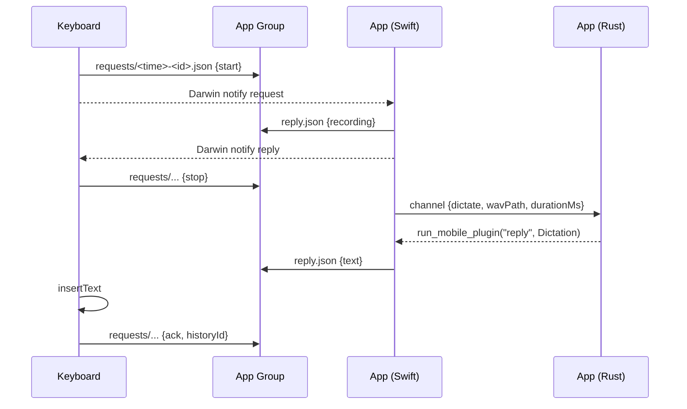

<!-- FilePath: docs/internal/ios-pending.md -->

# iPhone app: pending work

Android dictation is done (P3). The iPhone side (P1 iOS + P2) has only its foundation. This page
is the hand-off: what exists, what is left, and the design to build it to. Delete this page when
the last step is done and its content lives in `architecture.md` § 9 and `development.md`.

## State

| Done                                                            | Where                                        |
| --------------------------------------------------------------- | -------------------------------------------- |
| Xcode 27 and the iOS 27 simulator runtime installed             | this Mac                                     |
| Rust crates build for `aarch64-apple-ios-sim`                   | `cargo check --target aarch64-apple-ios-sim` |
| `cargo tauri ios init` run; Xcode project generated             | `mobile/src-tauri/gen/apple/`                |
| iOS minimum raised to 17.0 (Live Activity buttons need it)      | `tauri.conf.json`, `project.yml`, `Podfile`  |
| Scene manifest added (iOS 27 SDK crashes without it, see below) | `gen/apple/project.yml`                      |
| CocoaPods, XcodeGen, ios-deploy installed with Homebrew         | this Mac                                     |

Not yet confirmed: that the app opens after the scene-manifest fix. Run step 1 first.

## Known setup issues

- **`xcode-select` still points at the Command Line Tools.** Tauri's `ios dev` then fails with
  "tool 'xcodebuild' requires Xcode". Fix once: `sudo xcode-select -s /Applications/Xcode.app`.
  Until then, prefix commands with
  `DEVELOPER_DIR=/Applications/Xcode.app/Contents/Developer PATH=/Applications/Xcode.app/Contents/Developer/usr/bin:$PATH`.
- **iOS 27 launch crash** (`UIApplicationEvaluateRuntimeIssueForNoSceneLifecycleAdoption`):
  apps built with the iOS 27 SDK must use the scene life cycle. tao 0.35 switches to its scene
  delegate when `Info.plist` has `UIApplicationSceneManifest` with
  `UIApplicationSupportsMultipleScenes: true`; do not add an empty `UISceneConfigurations`
  (tauri-apps/tauri#15719). Upstream: tauri-apps/cargo-mobile2#519.
- **Regenerate the Xcode project** after editing `project.yml`:
  `cd mobile/src-tauri/gen/apple && xcodegen generate`. Never re-run `tauri ios init`; it
  overwrites `project.yml`.
- **Real iPhone:** a free Apple ID cannot create App Groups, so the keyboard cannot reach the app.
  The simulator does not enforce this. A device needs the Apple Developer Program.

## Steps

Each step ends with something you can see in the simulator (`just ios`, or the command below).

```sh
cd mobile && DEVELOPER_DIR=/Applications/Xcode.app/Contents/Developer cargo tauri ios dev "iPhone 17"
```

1. **App opens** (10 min). Rebuild with the command above; the four tabs show. If it still
   crashes, read the newest `~/Library/Logs/DiagnosticReports/Simple Voice-*.ips`.
2. **Settings fields** (30 min). Add to `sv-domain` `Settings` and `SettingsPatch`:
   `apple_speech_offline: bool` (default `true`) and `session_minutes: u32` (default 15,
   validated 5..=60 in `sv-storage`). No migration (settings are key/value rows). Mirror in
   `src/lib/api.ts`. Show both in `mobile/src/app/MobileSettings.tsx`, iPhone only.
3. **`sv-mobile` offline path** (45 min). Add `dictate_local(db, LocalTranscript, Recording)`:
   rules only (`sv_text::format`), model `APPLE_SPEECH`, status `Pasted`, no format model,
   audio deleted, returns `Dictation`. Extend `keyboard_status` with an
   `on_device_speech: bool` argument: offline + setting on + available gives
   "Apple Speech · offline", ready. Tests for both.
4. **`sv-native` plugin** (2 h). New crate `mobile/plugins/sv-native`
   (`tauri-plugin-sv-native`), `ios/` Swift package, no JS commands. See the bridge below.
   Check that `tauri::ios_plugin_binding!` passes `#![forbid(unsafe_code)]`; if it does not, the
   crate needs the same documented exception as `sv-ffi` (guard, AGENTS.md).
5. **Recording session in the app** (3 h). Swift in the plugin: microphone permission,
   `AVAudioSession` + `AVAudioEngine` kept running in the background (`UIBackgroundModes: audio`),
   16 kHz mono PCM16 WAV writer, session timer, App Group files, Darwin notifications,
   `NWPathMonitor`.
6. **Keyboard extension** (4 h). New Xcode target `Keyboard` (UIKit, Swift). Port the Android
   keyboard (`gen/android/.../keyboard/`): layouts, icons (SF Symbols in one weight), shift and
   caps lock, long-press digits and `!`/`?`, double-space full stop, space-bar cursor drag,
   suggestions from `UITextChecker` in the top bar, return key per `returnKeyType`, globe key
   only when `needsInputModeSwitchKey`. Mic talks to the app through the App Group.
   `RequestsOpenAccess: true`.
7. **Live Activity + Apple Speech** (2 h). Widget extension target with the Live Activity
   ("Simple Voice · ready · 12 min left", "Recording · 0:08", Stop). Stop is an
   `EndSessionIntent` (`LiveActivityIntent`) compiled into the app and widget targets; it posts
   the end-session Darwin notification. Apple Speech: `SpeechAnalyzer` + `SpeechTranscriber`
   (iOS 26+), on device, used only when offline and the setting is on.
8. **Project file** (30 min, alongside 6 and 7). `project.yml`: keyboard and widget targets
   embedded in the app, App Group entitlement on all three, URL scheme `simplevoice`,
   `NSMicrophoneUsageDescription`, `NSSupportsLiveActivities`, `UIBackgroundModes: [audio]`,
   frameworks `AVFoundation`, `ActivityKit`, `Speech`, `Network`.
9. **End-to-end test** (1 h). Simulator: enable the keyboard (Settings → General → Keyboard →
   Keyboards → Add, Allow Full Access), open Notes, tap the mic (the app opens once and starts a
   session), go back, dictate, text lands. Also: failed upload gives Retry; offline uses Apple
   Speech; Stop in the Live Activity ends the session. An XCUITest target can drive these taps.
10. **Finish** (30 min). `just check`, `cd mobile && just check`, docs (`architecture.md` § 9,
    `development.md`, requirements MB-2/4/7), plan page, `mobile/justfile` recipes
    (`ios`, `ios-build`, `xcodegen`), delete this page.

## Design

iPhone keyboards cannot use the microphone (MB-7), so the app records. The first mic tap opens
the app, which starts a session: recording stays available in the background for
`session_minutes`, shown as a Live Activity. Later taps never leave the keyboard.



### Identifiers

- App `dev.yuyudhan.simplevoice.mobile`, keyboard `….keyboard`, widget `….widget`.
- App Group `group.dev.yuyudhan.simplevoice.mobile`; files under `SimpleVoice/` in it.
- URL scheme `simplevoice://` (the keyboard opens the app with it).

### App Group files (JSON, atomic writes)

- `status.json`, app → keyboard: `{line, ready, needsKey, maxSeconds, session: {endsAt,
aliveAt} | null, recording: {startedAt} | null, updatedAt}`. The app refreshes `aliveAt` every
  5 s during a session; the keyboard treats a session as live while `endsAt` is ahead and
  `aliveAt` is under 15 s old.
- `requests/<ms>-<uuid>.json`, keyboard → app: `{id, kind, historyId?, at}`, `kind` one of
  `startSession`, `start`, `stop`, `cancel`, `retry`, `ack`. The app handles them in name order
  and deletes each.
- `reply.json`, app → keyboard: `{requestId, kind, text?, historyId?, message?, at}`, `kind` one
  of `recording`, `text`, `noSpeech`, `failed`, `error`, `sessionEnded`.
- Shared `UserDefaults` key `level` (0–1), written about 12 times a second while recording, for
  the keyboard's meter.

### Darwin notifications (no payload)

`dev.yuyudhan.simplevoice.request`, `.reply`, `.status`, `.endSession`.

### Keyboard mic states

| State              | Mic tap does                                               |
| ------------------ | ---------------------------------------------------------- |
| `needsKey`         | Opens the app on Settings                                  |
| No live session    | Writes `startSession`, opens `simplevoice://session`       |
| Session live, idle | `start`; "Recording" after the `recording` reply (3 s max) |
| Recording          | `stop`; "Transcribing…"; `text` → insert, then `ack`       |
| After `failed`     | Status tap sends `retry {historyId}`                       |

Leaving the field while recording sends `cancel`. If no `ack` arrives within 2 s of a `text`
reply, the app copies the text to the clipboard and calls `mark_history_not_pasted` (D-15).

### Bridge (Swift ↔ Rust inside the app)

- Rust registers the Swift plugin (`api.register_ios_plugin(init_plugin_sv_native)`), then
  calls `run_mobile_plugin("listen", {channel})` with a Rust-side `tauri::ipc::Channel::new`
  closure. Swift keeps the channel and sends requests through it:
  `{id, kind: "status", online, onDeviceSpeech}`,
  `{id, kind: "dictate", wavPath, durationMs}`,
  `{id, kind: "local", wavPath, durationMs, text, language?, transcribeMs}`,
  `{id, kind: "retry", historyId}`, `{id, kind: "notInserted", historyId}`.
- Rust answers with `run_mobile_plugin("reply", {id, body})`, `body` being a `Dictation`, a
  `KeyboardStatus` or `{kind: "error", message}`. After settings or key changes Rust calls
  `run_mobile_plugin("refresh")` so the status file stays current.
- The handlers live in the app crate (`features/session/`, iOS only), using `AppState`'s
  database and HTTP client; the plugin crate only carries messages.
- Online decides the path: online → `dictate` (Groq); offline with the setting on and Apple
  Speech available → Swift transcribes, then `local`; otherwise the keyboard says
  "No internet · can't dictate".
